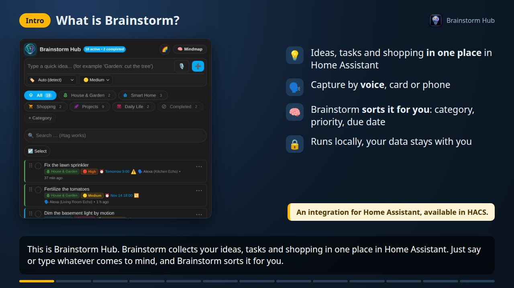

<div align="center">

# 🧠 Brainstorm Hub for Home Assistant

### Ideas, notes, to-do lists and mind maps, captured by voice with Amazon Alexa, Siri and Assist

**[🇬🇧 English](README.md)** &nbsp;|&nbsp; **[🇩🇪 Deutsch](README_de.md)** &nbsp;|&nbsp; **[📚 Wiki](https://github.com/nukleuz80/ha_brainstorm/wiki)**

[](https://my.home-assistant.io/redirect/hacs_repository/?owner=nukleuz80&repository=ha_brainstorm&category=integration)
[](https://github.com/hacs/default)
[](https://my.home-assistant.io/redirect/config_flow_start/?domain=brainstorm)
[](https://github.com/nukleuz80/ha_brainstorm/releases)
[](https://github.com/nukleuz80/ha_brainstorm/releases)
[](https://contributors.home-assistant.io/core/quality-scale/)
[](https://github.com/nukleuz80/ha_brainstorm/wiki)
[](https://opensource.org/licenses/MIT)
[](https://github.com/nukleuz80/ha_brainstorm)

[](docs/videos_en.md)

</div>

**Brainstorm Hub** is a free, local [Home Assistant](https://www.home-assistant.io/) integration for **ideas, notes, tasks and shopping lists**, available in the **HACS default store**. Capture a thought in seconds by voice through **Amazon Alexa** (Echo and Echo Show), **Home Assistant Assist**, **Siri** or an **AI assistant**, or type it into the dashboard. Brainstorm cleans up the sentence, picks the category, priority and due date by itself and shows everything in a **list card** and an **interactive mind map card** with tree, Kanban, timeline, Eisenhower matrix and pinboard views. Share lists with your family, get reminders on your Echo or phone, sync with **Bring!**, **Todoist** or **Google Tasks**, and export to **Markdown for Obsidian or Logseq**. Everything runs locally in Home Assistant, with no account and no cloud.

> [!NOTE]
> **🎉 In HACS since 9 November 2026:** Brainstorm Hub is part of the [HACS default list](https://github.com/hacs/default/pull/13619). Just search for **Brainstorm Hub** in HACS.

> [!TIP]
> **📚 [The wiki](https://github.com/nukleuz80/ha_brainstorm/wiki)** has the full documentation in English and German: [Quick Start](https://github.com/nukleuz80/ha_brainstorm/wiki/Quick-Start), every setting, every service, voice commands, examples and troubleshooting. **🎬 [Videos](docs/videos_en.md)** show the main features in 4 minutes, plus installation, the Alexa skill, reminders, the iPhone shortcut and privacy.

## 📑 Contents

- [Why Brainstorm Hub?](#-why-brainstorm-hub)
- [Features](#-features)
- [Installation](#-installation)
- [Dashboard cards](#-dashboard-cards)
- [Voice commands](#️-voice-commands)
- [Services](#️-services)
- [Language support](#-language-support)
- [FAQ](#-faq)
- [Documentation](#-documentation)
- [Changelog](#-changelog)
- [Feedback & contributing](#-feedback--contributing)

---

## 💡 Why Brainstorm Hub?

> 🗣️ *"Alexa, ask Brainstorm to note the lawn has to be mowed"* ➔ 🤖 *"Saved under House and Garden."*<br>
> 🗣️ *"Alexa, ask Brainstorm to remind me tomorrow at 8 to take out the bins"* ➔ 🤖 *"Okay, I will remind you tomorrow at 8 am about Take out bins."*

- 🗣️ **Hands-free capture on every Echo:** your own Alexa skill answers in one sentence, without shopping-list mix-ups or the band *Brainstorm* starting on Spotify. An Echo Show shows your lists as tiles you can tick off.
- 🧠 **Understands what you mean:** *"the lawn has to be mowed"* becomes *Mow lawn*. Category (*"for the garden"*), priority (*"urgent"*, *"priority 1"*) and due date (*"tomorrow at 8"*) come straight from the sentence, in English and German.
- 🗺️ **List and mind map in one:** the same ideas as a fast list or as a mind map you can drag, fold, filter, draw on and present.
- 👥 **Made for households and teams:** private or shared lists, voting, comments, hidden brainstorm rounds and live presence.
- 🏠 **100 % Home Assistant:** native to-do entities, a sensor, more than 25 actions, events for automations, LLM tools for Assist, built to the official [developer guidelines](https://contributors.home-assistant.io/).

---

## ✨ Features

### 🗣️ Voice capture
- **Amazon Alexa:** your own skill (one sentence, one answer), a two-way dialog or one-shot direct commands, with the Echo the idea came from. Lists on the **Echo Show** with swipe, tick-off and fold. → [Voice Control](https://github.com/nukleuz80/ha_brainstorm/wiki/Voice-Control)
- **Home Assistant Assist:** custom sentences and the built-in to-do list commands.
- **Siri on the iPhone:** a shortcut on the Action button, a back tap or *"Hey Siri, Brainstorm"*.
- **Microphone in the card:** speak into the quick input, check the text, save.
- **Smart text cleanup:** filler words go, passive sentences become tasks, typos and names are fixed; optional AI step.

### 📋 List card
- Quick input with automatic category and priority, category pills, search with `#tags`, subtasks you can fold and drag.
- Title and description, attachments (photos, screenshots, PDFs), markers, progress, repeating tasks, links and a little Markdown.
- Long-press menu, multi-select, sharing, three operating levels from *Beginner* to *Pro*. → [List Card](https://github.com/nukleuz80/ha_brainstorm/wiki/List-Card)

### 🧠 Mind map card
- **Views:** radial, tree, org chart, outline, 📌 pinboard with sticky notes, Kanban by status, timeline by due date and Eisenhower matrix.
- **Work on the map:** drag and drop, fold branches, focus mode, cross links, frames and callouts, keyboard shortcuts, undo, minimap, presentation mode and ⚡ timed brainstorm mode.
- **Freehand drawing:** pen, arrows and circles over the map, saved per category on every device.
- **Look and export:** four templates and ten node shapes; export as SVG, PNG, PDF, Markdown outline, OPML or FreeMind `.mm`; import outlines and ready content templates (SWOT, pros and cons, project plan). → [Mind Map & Pinboard](https://github.com/nukleuz80/ha_brainstorm/wiki/Mind-Map-and-Pinboard)

### 👥 Collaboration & privacy
- Private entries per person, sharing per entry or category (view or edit), Echos assigned to people.
- 🗳️ Voting with a ranking, 👍 reactions, 💬 comments with **@mentions**, 🙈 hidden brainstorm rounds and live avatars of who is on the map. → [Collaboration](https://github.com/nukleuz80/ha_brainstorm/wiki/Collaboration)

### ✨ AI features (optional)
- **LLM tools for Assist:** OpenAI, Google Gemini, Ollama and other conversation agents can add, find, complete and delete ideas in plain language.
- **With an AI task entity:** subtask suggestions, a mind map from a topic or text, grouping loose ideas into themes, branch summaries.
- **Backlog for coding AIs:** a category as the task list for Claude Code and other agents over MCP, with result notes. → [AI Features](https://github.com/nukleuz80/ha_brainstorm/wiki/AI-Features)

### ⏰ Reminders
- Due dates from speech, the cards or to-do lists; reminders spoken by an Echo, pushed to the Companion app with **Done**, **1 hour later** and **Tomorrow** buttons, or added to a calendar.
- Quiet hours, daily briefing, weekly review, rules per list, coming home and place-based reminders, reminders for other people, real Alexa reminders. → [Reminders](https://github.com/nukleuz80/ha_brainstorm/wiki/Reminders)

### 🔁 Lists, sync & data
- Every category is a native Home Assistant **to-do list** (`todo.*`).
- Two-way sync with **Bring!**, **Google Tasks**, **Todoist** or any other to-do list.
- **Tasks from sensors:** a filter after 300 operating hours, a plant that is too dry, a finished washing machine or a low battery becomes a task that ticks itself off. → [Settings](https://github.com/nukleuz80/ha_brainstorm/wiki/Settings#brainstorm---sensor-tasks)
- Automatic **Markdown export** for Obsidian, Logseq or Nextcloud; JSON export and import; automatic cleanup of done entries. → [Import, Export & Storage](https://github.com/nukleuz80/ha_brainstorm/wiki/Import-Export-and-Storage)

---

## 📦 Installation

**Requirements:** Home Assistant 2026.10 or newer. Optional: [HACS](https://hacs.xyz), the [Alexa Media Player](https://github.com/alandtse/alexa_media_player) integration for Alexa voice input, and an Amazon developer account plus a public HTTPS address for your own Alexa skill. Brainstorm Hub connects to no external service by itself, so setup needs no account or password.

### Option 1: HACS (recommended)

[](https://my.home-assistant.io/redirect/hacs_repository/?owner=nukleuz80&repository=ha_brainstorm&category=integration)

1. Open **HACS** in Home Assistant.
2. Search for **Brainstorm Hub** and click **Download**.
3. Restart Home Assistant.

### Option 2: Manual installation

1. Download the [latest release](https://github.com/nukleuz80/ha_brainstorm/releases/latest).
2. Copy the folder `custom_components/brainstorm` to `/config/custom_components/`.
3. Restart Home Assistant.

### Set up the integration

[](https://my.home-assistant.io/redirect/config_flow_start/?domain=brainstorm)

Go to [**Settings ➔ Devices & Services ➔ Add Integration**](https://my.home-assistant.io/redirect/config_flow_start/?domain=brainstorm), search for **Brainstorm Hub** and follow the steps. Everything else is under **Configure**, see [Settings](https://github.com/nukleuz80/ha_brainstorm/wiki/Settings).

The cards come with the integration: Home Assistant loads them by itself, with nothing to copy and no resource to add.

> **Updating from a version before 1.7.15:** remove the old resources `/local/brainstorm-card.js` and `/local/brainstorm-mindmap-card.js` under [**Settings ➔ Dashboards ➔ Resources**](https://my.home-assistant.io/redirect/lovelace_resources/) and delete the card files in `/config/www/`.

Quick links, removing the integration and all details: [Installation & Setup](https://github.com/nukleuz80/ha_brainstorm/wiki/Installation-and-Setup) · [Quick Start](https://github.com/nukleuz80/ha_brainstorm/wiki/Quick-Start)

---

## 🎴 Dashboard cards

**List card** with quick input, filters and a switch to the mind map:

```yaml
type: custom:brainstorm-card
title: Brainstorm Hub
```

**Mind map card**, also great as a full-screen panel on a tablet:

```yaml
type: custom:brainstorm-mindmap-card
title: Brainstorm Mindmap
height: 600px
default_category: Inbox   # or 'all'
layout: radial            # radial, tree, org, outline, pin, kanban, timeline, matrix
map_template: standard    # standard, clean, sketch, neon
```

Every option is in the visual card editor and in the wiki: [List Card](https://github.com/nukleuz80/ha_brainstorm/wiki/List-Card) · [Mind Map & Pinboard](https://github.com/nukleuz80/ha_brainstorm/wiki/Mind-Map-and-Pinboard)

---

## 🗣️ Voice commands

The skill follows the language of your Echo, everything else the language of Home Assistant. All sentences, German ones included, and what Brainstorm reads from them are on [Voice Control](https://github.com/nukleuz80/ha_brainstorm/wiki/Voice-Control).

### Alexa skill (recommended)

Your own skill is the most reliable way ([setup](https://github.com/nukleuz80/ha_brainstorm/wiki/Voice-Control#️-optional-your-own-alexa-skill-one-sentence-one-answer), 🎬 [video](docs/videos_en.md#your-own-alexa-skill-6-minutes)). Start each sentence with *"Alexa, ask Brainstorm to"*:

| You say | What happens |
| :--- | :--- |
| *"note dim the basement light"* | Saves a note. Also: *idea*, *remember*, *add*, *write down* |
| *"remind me tomorrow at 8 to take out the bins"* | Saves a note with a reminder |
| *"done take out the bins"* or *"done"* | Completes a note, or the last reminder |
| *"later"* | Moves the last reminder by one hour |
| *"read"* or *"read daily life"* | Gives the overview, or reads a category |
| *"read everything"* | Reads all notes |
| *"show my lists"* or *"show daily life"* | Shows the lists on an Echo with a screen |

### Alexa dialog and direct commands

- **Dialog:** *"Alexa, brainstorm"*, Alexa asks for your note and confirms the category. Needs the Alexa Actionable Notifications skill and [`examples/alexa_dialog.en.yaml`](examples/alexa_dialog.en.yaml).
- **Direct:** *"Alexa, note dim the basement light"*, *"Alexa, idea repair the sprinkler"*, *"Alexa, remember to fertilize the tomatoes"*, with [`examples/alexa_direct_commands.en.yaml`](examples/alexa_direct_commands.en.yaml).

### Home Assistant Assist

- **Brainstorm sentences** ([`examples/custom_sentences/en/brainstorm.yaml`](examples/custom_sentences/en/brainstorm.yaml) and [`examples/intent_script.en.yaml`](examples/intent_script.en.yaml)): *"Add mow the lawn to Brainstorm"*, *"New idea water the flowers"*, *"Note create a database backup"*, *"Remember to change the tires"*, *"What is in daily life in Brainstorm?"*
- **To-do list sentences**, built in: *"Add milk to the Brainstorm Hub Inbox list"*, *"Check off milk on the Brainstorm Hub Inbox list"*

### Siri, microphone and AI assistants

- **iPhone:** a shortcut with *Dictate text* and the action `brainstorm.add_idea`, started by *"Hey Siri, Brainstorm"*, the Action button or a back tap.
- **Microphone:** 🎙️ next to the quick input of the list card (needs HTTPS and an Assist pipeline with speech-to-text).
- **AI assistant:** select **Brainstorm Hub** under *Control Home Assistant* of a conversation agent and ask *"What is still on my garden list?"*

---

## 🛠️ Services

| Service | What it does |
| :--- | :--- |
| `brainstorm.add_idea` / `update_idea` / `delete_idea` | Add, change, complete or delete an idea, with category, priority, due date, description and more |
| `brainstorm.get_ideas` / `get_announcement` | Return ideas as a response, or a ready text to read out |
| `brainstorm.add_category` / `remove_category` / `set_category_style` | Manage categories, icons and colors |
| `brainstorm.export_markdown` / `export_json` / `import_json` | Back up and move your ideas |
| `brainstorm.import_outline` / `sort_children` / `reorder_ideas` | Insert outlines and sort notes |
| `brainstorm.start_voting` / `vote` / `end_voting` / `react` | Votes and reactions |
| `brainstorm.add_comment` / `delete_comment` | Comments with @mentions |
| `brainstorm.start_round` / `end_round` / `group_ideas` | Hidden rounds and grouping into themes |
| `brainstorm.share` / `delete_done` / `restore_idea` / `bring_message` | Sharing, cleanup, undo delete, Bring! messages |

Every field, events such as `brainstorm_reminder_due` and the sensor attributes: [Services & Events](https://github.com/nukleuz80/ha_brainstorm/wiki/Services-and-Events) · [Entities & Attributes](https://github.com/nukleuz80/ha_brainstorm/wiki/Entities-and-Attributes) · [Automations & Examples](https://github.com/nukleuz80/ha_brainstorm/wiki/Automations-and-Examples)

---

## 🌍 Language support

Brainstorm Hub works in English and German, and your existing categories and entries are never translated or renamed. To add a language, see [`CONTRIBUTING.md`](CONTRIBUTING.md).

| Area | English | German |
| :--- | :--- | :--- |
| Settings, dashboard cards, documentation | ✅ | ✅ |
| Alexa skill: commands and spoken answers | ✅ | ✅ |
| Assist sentences | ✅ (`examples/`) | ✅ |
| Shortening sentences, due dates and priorities from speech | ✅ | ✅ |
| Reminder texts, logbook and error messages | ✅ | ✅ |

---

## ❓ FAQ

**Is Brainstorm Hub free, and does it need a cloud?**
It is free and open source (MIT) and runs locally in Home Assistant. Only your own Alexa skill needs a public HTTPS address, for example through Home Assistant Cloud.

**Do I need Alexa or an AI?**
No. The cards, Assist, Siri, to-do lists and automations work without Alexa. Category, priority and due date come from built-in rules; an AI is an optional extra.

**Can my family share lists?**
Yes, with private lists and sharing per entry or category, see [Collaboration](https://github.com/nukleuz80/ha_brainstorm/wiki/Collaboration).

**Does it sync with Bring!, Todoist, Google Tasks or Obsidian?**
Yes: linked to-do lists in both directions, a native Bring! connection and a Markdown export for Obsidian and Logseq.

**Something does not work?**
See [Troubleshooting & FAQ](https://github.com/nukleuz80/ha_brainstorm/wiki/Troubleshooting-and-FAQ), download the diagnostics and open an [issue](https://github.com/nukleuz80/ha_brainstorm/issues).

---

## 📚 Documentation

| Getting started | How-to guides | Reference |
| :--- | :--- | :--- |
| [Installation & Setup](https://github.com/nukleuz80/ha_brainstorm/wiki/Installation-and-Setup) | [List Card](https://github.com/nukleuz80/ha_brainstorm/wiki/List-Card) | [Settings](https://github.com/nukleuz80/ha_brainstorm/wiki/Settings) |
| [Quick Start](https://github.com/nukleuz80/ha_brainstorm/wiki/Quick-Start) | [Mind Map & Pinboard](https://github.com/nukleuz80/ha_brainstorm/wiki/Mind-Map-and-Pinboard) | [Services & Events](https://github.com/nukleuz80/ha_brainstorm/wiki/Services-and-Events) |
| [Troubleshooting & FAQ](https://github.com/nukleuz80/ha_brainstorm/wiki/Troubleshooting-and-FAQ) | [Collaboration](https://github.com/nukleuz80/ha_brainstorm/wiki/Collaboration) | [Entities & Attributes](https://github.com/nukleuz80/ha_brainstorm/wiki/Entities-and-Attributes) |
| [🎬 Videos](docs/videos_en.md) | [Voice Control](https://github.com/nukleuz80/ha_brainstorm/wiki/Voice-Control) | [Import, Export & Storage](https://github.com/nukleuz80/ha_brainstorm/wiki/Import-Export-and-Storage) |
| [📜 Changelog](CHANGELOG.md) | [AI Features](https://github.com/nukleuz80/ha_brainstorm/wiki/AI-Features) | |
| | [Reminders](https://github.com/nukleuz80/ha_brainstorm/wiki/Reminders) | |
| | [Automations & Examples](https://github.com/nukleuz80/ha_brainstorm/wiki/Automations-and-Examples) | |

---

## 📜 Changelog

The latest versions; every version is in [CHANGELOG.md](CHANGELOG.md).

| Version | Date | Status & Highlights |
| :--- | :--- | :--- |
| **`v1.11.10`** | 2026-11-14 | **Tasks from sensors.** New section *📟 Sensor tasks* in the settings: a rule creates a task as soon as an entity reaches or exceeds a value, falls to one or has a given state, such as *Change the water filter* after 300 operating hours or *Empty the washing machine* once it has finished. Once the sensor is back to normal, the task ticks itself off; an optional *Back to normal at* value stops a sensor at the limit from creating and closing tasks all the time. One task per occurrence; ticked off by hand, it only comes back with the next occurrence. The description names the sensor and its value, and the cards show the source 📟 Sensor. |
| **`v1.11.9`** | 2026-11-11 | **Documentation in the wiki.** The full documentation moved to the [GitHub wiki](https://github.com/nukleuz80/ha_brainstorm/wiki) in English and German: 14 pages per language from *Quick Start* to *Services & Events*, with a sidebar and a link to the other language on every page. A GitHub Action builds the wiki from the new `wiki/` folder, and a test checks every link. The READMEs are shorter and lead with what Brainstorm Hub does, the complete version history is in `CHANGELOG.md` and `CHANGELOG_de.md`, `docs/guide.md` and `docs/anleitung.md` point to the wiki, and `manifest.json` links the wiki as documentation. |
| **`v1.11.8`** | 2026-11-11 | **Live presence.** Avatars at the top left of the mind map show who has the same list open right now; whoever edits a note (dialog or right on the map) gets a ring, and the note shows ✏️ with the name. New WebSocket commands `brainstorm/presence/subscribe` and `presence/update`, in memory only: closing the card or losing the connection removes the person. |
| **`v1.11.7`** | 2026-11-11 | **Freehand drawing.** 🖍️ or **D** on the round map of a category: pen, arrow and circle in six colours and three widths, eraser, delete all, ↶ for every step. Kept per category (up to 300 strokes), shown on every device, part of the picture, PDF and JSON export. New WebSocket commands `brainstorm/drawing`, `add_stroke` and `delete_strokes`; the sensor counts changes in `drawing_revs`. |
| **`v1.11.6`** | 2026-11-11 | **Pinboard.** New view 📌 (`layout: pin`): notes as coloured sticky notes without a tree, free to move; the place is kept per note and holds on every device, the colour comes from ⋯. Frames group notes, ↶ takes back moves and colours. New WebSocket command `brainstorm/pins`; place and colour go into the JSON export and are dropped when a note changes category. |

---

## 💬 Feedback & contributing

I am truly grateful for every piece of feedback. Brainstorm Hub grew out of my own everyday life, and your experience is what makes it better for everyone.

- **Something does not work?** Open an [issue](https://github.com/nukleuz80/ha_brainstorm/issues). The diagnostics help a lot.
- **An idea or a wish?** An [issue](https://github.com/nukleuz80/ha_brainstorm/issues) is welcome for that too. Small ideas are as welcome as big ones.
- **Want to improve something yourself?** Pull requests are very welcome, whether code, translations, docs or typos. The wiki is built from the [`wiki/`](wiki/) folder, so documentation changes are pull requests too. For bigger changes, let's talk briefly in an issue first, see [`CONTRIBUTING.md`](CONTRIBUTING.md).
- **Just tell me** how you use Brainstorm. That helps me shape where it goes next, too.

---

## ✨ 🚀 Crafted with Pure Vibe Coding

> *“Vibe coding is the art of turning pure ideas into reality through fluid conversation, human creativity, and AI superpowers.”*

This project was built and continues to grow with pure passion and full devotion to **Vibe Coding**. We don't hide the AI — we celebrate it openly and proudly:
- **Human Product & UX Vision:** Every feature, every mobile gesture, every mindmap detail, and every voice routine is born from real-life smart home needs and a genuine love for great UX.
- **High-Velocity AI Pair Programming:** Powered by advanced agentic AI coding assistants (Google Antigravity & Claude/Gemini), turning ambitious architecture, bug fixes, and polish into reality at lightning speed.
- **100% Open Source & Community First:** Transparent, hackable, and built for everyone in the Home Assistant ecosystem.

---

## 📄 License

This project is licensed under the **MIT License**, see [LICENSE](LICENSE).

Copyright © 2026 [nukleuz80](https://github.com/nukleuz80)
