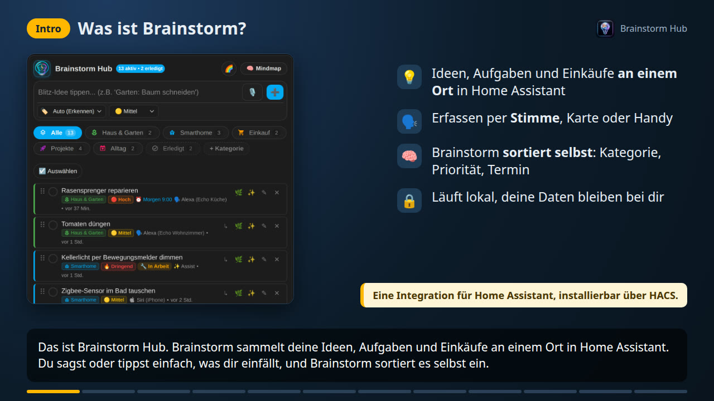

<div align="center">

# 🧠 Brainstorm Hub für Home Assistant

### Ideen, Notizen, To-do-Listen und Mindmaps, per Sprache erfasst mit Amazon Alexa, Siri und Assist

**[🇩🇪 Deutsch](README_de.md)** &nbsp;|&nbsp; **[🇬🇧 English](README.md)** &nbsp;|&nbsp; **[📚 Wiki](https://github.com/nukleuz80/ha_brainstorm/wiki)**

[](https://my.home-assistant.io/redirect/hacs_repository/?owner=nukleuz80&repository=ha_brainstorm&category=integration)
[](https://github.com/hacs/default)
[](https://my.home-assistant.io/redirect/config_flow_start/?domain=brainstorm)
[](https://github.com/nukleuz80/ha_brainstorm/releases)
[](https://github.com/nukleuz80/ha_brainstorm/releases)
[](https://contributors.home-assistant.io/core/quality-scale/)
[](https://github.com/nukleuz80/ha_brainstorm/wiki)
[](https://opensource.org/licenses/MIT)
[](https://github.com/nukleuz80/ha_brainstorm)

[](docs/videos.md)

</div>

**Brainstorm Hub** ist eine kostenlose, lokale [Home-Assistant](https://www.home-assistant.io/)-Integration für **Ideen, Notizen, Aufgaben und Einkaufslisten**, direkt aus dem **HACS-Standardkatalog**. Erfasse einen Gedanken in Sekunden per Sprache über **Amazon Alexa** (Echo und Echo Show), **Home Assistant Assist**, **Siri** oder einen **KI-Assistenten**, oder tippe ihn ins Dashboard. Brainstorm räumt den Satz auf, erkennt Kategorie, Priorität und Termin von selbst und zeigt alles in einer **Listenkarte** und einer **interaktiven Mindmap-Karte** mit Baum, Kanban, Zeitleiste, Eisenhower-Matrix und Pinnwand. Teile Listen mit der Familie, lass dich per Echo oder Handy erinnern, gleiche mit **Bring!**, **Todoist** oder **Google Tasks** ab und exportiere als **Markdown für Obsidian oder Logseq**. Alles läuft lokal in Home Assistant, ohne Konto und ohne Cloud.

> [!NOTE]
> **🎉 Seit 9. November 2026 in HACS:** Brainstorm Hub steht in der [Standardliste von HACS](https://github.com/hacs/default/pull/13619). Such in HACS einfach nach **Brainstorm Hub**.

> [!TIP]
> **📚 [Das Wiki](https://github.com/nukleuz80/ha_brainstorm/wiki)** enthält die vollständige Doku auf Deutsch und Englisch: [Schnellstart](https://github.com/nukleuz80/ha_brainstorm/wiki/Schnellstart), alle Einstellungen, alle Dienste, Sprachbefehle, Beispiele und Fehlerbehebung. **🎬 [Videos](docs/videos.md)** zeigen die wichtigsten Funktionen in 3 Minuten.

## 📑 Inhalt

- [Warum Brainstorm Hub?](#-warum-brainstorm-hub)
- [Funktionen](#-funktionen)
- [Installation](#-installation)
- [Dashboard-Karten](#-dashboard-karten)
- [Sprachbefehle](#️-sprachbefehle)
- [Dienste](#️-dienste)
- [Sprachunterstützung](#-sprachunterstützung)
- [Häufige Fragen](#-häufige-fragen)
- [Dokumentation](#-dokumentation)
- [Changelog](#-changelog)
- [Feedback & Mitmachen](#-feedback--mitmachen)

---

## 💡 Warum Brainstorm Hub?

> 🗣️ *„Alexa, Brainstorm“* ➔ 🤖 *„Brainstorm bereit. Sprich deine Notiz oder sage Ansage.“*<br>
> 🗣️ *„Dringend Garten: Rasenmäher reparieren“* ➔ 🤖 *„Gespeichert unter Haus & Garten [🔥 Dringend].“*

- 🗣️ **Freihändig an jedem Echo:** Dein eigener Alexa-Skill antwortet in einem Satz, ohne Einkaufslisten-Verwechslung und ohne dass die Band *Brainstorm* auf Spotify startet. Ein Echo Show zeigt deine Listen als Kacheln zum Abhaken.
- 🧠 **Versteht, was du meinst:** *„der Rasen muss gemäht werden“* wird zu *Rasen mähen*. Kategorie (*„für den Garten“*), Priorität (*„dringend“*, *„Prio 1“*) und Termin (*„morgen um 8“*) kommen direkt aus dem Satz, auf Deutsch und Englisch.
- 🗺️ **Liste und Mindmap in einem:** Dieselben Ideen als schnelle Liste oder als Mindmap zum Ziehen, Einklappen, Filtern, Bemalen und Präsentieren.
- 👥 **Für Haushalt und Team:** Private oder geteilte Listen, Abstimmungen, Kommentare, verdeckte Brainstorm-Runden und Live-Präsenz.
- 🏠 **100 % Home Assistant:** Echte To-do-Entitäten, ein Sensor, mehr als 25 Aktionen, Ereignisse für Automationen, LLM-Werkzeuge für Assist, gebaut nach den offiziellen [Entwicklerrichtlinien](https://contributors.home-assistant.io/).

---

## ✨ Funktionen

### 🗣️ Spracherfassung
- **Amazon Alexa:** Eigener Skill (ein Satz, eine Antwort), Zwei-Wege-Dialog oder Direktbefehle, jeweils mit dem Echo, von dem die Idee kam. Listen auf dem **Echo Show** mit Wischen, Abhaken und Aufklappen. → [Sprachsteuerung](https://github.com/nukleuz80/ha_brainstorm/wiki/Sprachsteuerung)
- **Home Assistant Assist:** Eigene Sätze und die eingebauten Listenbefehle.
- **Siri am iPhone:** Kurzbefehl auf der Action-Taste, per Doppeltippen auf die Rückseite oder *„Hey Siri, Brainstorm“*.
- **Mikrofon in der Karte:** In die Schnelleingabe sprechen, Text prüfen, speichern.
- **Textbereinigung:** Füllwörter fliegen raus, Passivsätze werden zu Aufgaben, Tippfehler und Namen werden korrigiert; optional mit KI.

### 📋 Listenkarte
- Schnelleingabe mit automatischer Kategorie und Priorität, Kategorie-Chips, Suche mit `#Tags`, Unteraufgaben zum Einklappen und Ziehen.
- Titel und Beschreibung, Anhänge (Fotos, Screenshots, PDFs), Marker, Fortschritt, wiederkehrende Aufgaben, Links und etwas Markdown.
- Menü bei langem Drücken, Mehrfachauswahl, Freigaben und drei Bedienstufen von *Einsteiger* bis *Profi*. → [Listenkarte](https://github.com/nukleuz80/ha_brainstorm/wiki/Listenkarte)

### 🧠 Mindmap-Karte
- **Ansichten:** Rund, Baum, Organigramm, Gliederung, 📌 Pinnwand mit Haftzetteln, Kanban nach Status, Zeitleiste nach Fälligkeit und Eisenhower-Matrix.
- **Arbeiten auf der Map:** Ziehen und Ablegen, Zweige einklappen, Fokus, Querverbindungen, Rahmen und Callouts, Tastenkürzel, Rückgängig, Minimap, Präsentationsmodus und ⚡ Brainstorm-Modus mit Timer.
- **Freihand zeichnen:** Stift, Pfeile und Kreise über der Map, pro Kategorie gespeichert und auf jedem Gerät zu sehen.
- **Aussehen und Export:** Vier Vorlagen und zehn Formen; Export als SVG, PNG, PDF, Markdown-Gliederung, OPML oder FreeMind `.mm`; Gliederungen einfügen und fertige Inhaltsvorlagen (SWOT, Pro und Contra, Projektplan). → [Mindmap & Pinnwand](https://github.com/nukleuz80/ha_brainstorm/wiki/Mindmap-und-Pinnwand)

### 👥 Zusammenarbeit & Privatsphäre
- Private Einträge pro Person, Freigaben pro Eintrag oder Kategorie (Ansehen oder Bearbeiten), Echos einer Person zugeordnet.
- 🗳️ Abstimmungen mit Rangliste, 👍 Reaktionen, 💬 Kommentare mit **@Erwähnung**, 🙈 verdeckte Brainstorm-Runden und Live-Avatare, wer gerade auf der Map ist. → [Zusammenarbeit](https://github.com/nukleuz80/ha_brainstorm/wiki/Zusammenarbeit)

### ✨ KI-Funktionen (optional)
- **LLM-Werkzeuge für Assist:** OpenAI, Google Gemini, Ollama und andere Gesprächsagenten legen Ideen in normaler Sprache an, finden, erledigen und löschen sie.
- **Mit einer KI-Aufgaben-Entität:** Vorschläge für Unteraufgaben, eine Mindmap aus einem Thema oder Text, lose Ideen nach Themen gruppieren, Äste zusammenfassen.
- **Backlog für Coding-KIs:** Eine Kategorie als Aufgabenliste für Claude Code und andere Agenten über MCP, mit Ergebnis-Notizen. → [KI-Funktionen](https://github.com/nukleuz80/ha_brainstorm/wiki/KI-Funktionen)

### ⏰ Erinnerungen
- Termine aus der Sprache, den Karten oder den To-do-Listen; Erinnerungen gesprochen vom Echo, als Push in die Companion-App mit den Knöpfen **Erledigt**, **1 Stunde später** und **Morgen** oder im Kalender.
- Ruhezeit, tägliches Briefing, Wochenrückblick, Regeln pro Liste, Erinnern beim Heimkommen und an Orten, Erinnerungen für andere, echte Alexa-Erinnerungen. → [Erinnerungen](https://github.com/nukleuz80/ha_brainstorm/wiki/Erinnerungen)

### 🔁 Listen, Abgleich & Daten
- Jede Kategorie ist eine echte **To-do-Liste** in Home Assistant (`todo.*`).
- Abgleich in beide Richtungen mit **Bring!**, **Google Tasks**, **Todoist** oder jeder anderen To-do-Liste.
- **Aufgaben aus Sensoren:** Filter nach 300 Betriebsstunden, zu trockene Pflanze, fertige Waschmaschine oder schwache Batterie werden zur Aufgabe, die sich selbst abhakt. → [Einstellungen](https://github.com/nukleuz80/ha_brainstorm/wiki/Einstellungen#brainstorm---sensor-aufgaben)
- Automatischer **Markdown-Export** für Obsidian, Logseq oder Nextcloud; JSON-Export und -Import; erledigte Einträge räumen sich auf Wunsch selbst auf. → [Import, Export & Speicherung](https://github.com/nukleuz80/ha_brainstorm/wiki/Import-Export-und-Speicherung)

---

## 📦 Installation

**Voraussetzungen:** Home Assistant 2026.10 oder neuer. Optional: [HACS](https://hacs.xyz), die Integration [Alexa Media Player](https://github.com/alandtse/alexa_media_player) für die Spracheingabe mit Alexa sowie ein Amazon-Entwicklerkonto und eine öffentliche HTTPS-Adresse für einen eigenen Alexa-Skill. Brainstorm Hub verbindet sich von selbst mit keinem externen Dienst, die Einrichtung braucht also weder Konto noch Passwort.

### Methode 1: Über HACS (empfohlen)

[](https://my.home-assistant.io/redirect/hacs_repository/?owner=nukleuz80&repository=ha_brainstorm&category=integration)

1. Öffne **HACS** in deinem Home Assistant.
2. Suche nach **Brainstorm Hub** und klicke auf **Herunterladen**.
3. Starte Home Assistant neu.

### Methode 2: Manuelle Installation

1. Lade das [neueste Release](https://github.com/nukleuz80/ha_brainstorm/releases/latest) herunter.
2. Kopiere den Ordner `custom_components/brainstorm` nach `/config/custom_components/`.
3. Starte Home Assistant neu.

### Integration einrichten

[](https://my.home-assistant.io/redirect/config_flow_start/?domain=brainstorm)

Gehe auf [**Einstellungen ➔ Geräte & Dienste ➔ Integration hinzufügen**](https://my.home-assistant.io/redirect/config_flow_start/?domain=brainstorm), suche nach **Brainstorm Hub** und folge den Schritten. Alles Weitere steht unter **Konfigurieren**, siehe [Einstellungen](https://github.com/nukleuz80/ha_brainstorm/wiki/Einstellungen).

Die Karten kommen mit der Integration: Home Assistant lädt sie selbst, ohne Kopieren und ohne Ressourcen-Eintrag.

> **Update von einer Version vor 1.7.15:** Entferne die alten Ressourcen `/local/brainstorm-card.js` und `/local/brainstorm-mindmap-card.js` unter [*Einstellungen ➔ Dashboards ➔ Ressourcen*](https://my.home-assistant.io/redirect/lovelace_resources/) und lösche die Karten-Dateien in `/config/www/`.

Schnelllinks, Entfernen der Integration und alle Details: [Installation & Einrichtung](https://github.com/nukleuz80/ha_brainstorm/wiki/Installation-und-Einrichtung) · [Schnellstart](https://github.com/nukleuz80/ha_brainstorm/wiki/Schnellstart)

---

## 🎴 Dashboard-Karten

**Listenkarte** mit Schnelleingabe, Filtern und Umschalter zur Mindmap:

```yaml
type: custom:brainstorm-card
title: Brainstorm Hub
```

**Mindmap-Karte**, auch ideal als Vollbild-Panel auf dem Tablet:

```yaml
type: custom:brainstorm-mindmap-card
title: Brainstorm Mindmap
height: 600px
default_category: Inbox   # oder 'all'
layout: radial            # radial, tree, org, outline, pin, kanban, timeline, matrix
map_template: standard    # standard, clean, sketch, neon
```

Alle Optionen gibt es im grafischen Karten-Editor und im Wiki: [Listenkarte](https://github.com/nukleuz80/ha_brainstorm/wiki/Listenkarte) · [Mindmap & Pinnwand](https://github.com/nukleuz80/ha_brainstorm/wiki/Mindmap-und-Pinnwand)

---

## 🗣️ Sprachbefehle

Der Skill folgt der Sprache deines Echos, alles andere der Sprache von Home Assistant. Alle Sätze und was Brainstorm daraus liest, stehen unter [Sprachsteuerung](https://github.com/nukleuz80/ha_brainstorm/wiki/Sprachsteuerung).

### Eigener Alexa-Skill (empfohlen)

Der zuverlässigste Weg ([Einrichtung](https://github.com/nukleuz80/ha_brainstorm/wiki/Sprachsteuerung#variante-c-eigener-alexa-skill-optional-ein-satz-eine-antwort), 🎬 [Video](docs/video-alexa-skill.md)). Alle Sätze beginnen mit **„Alexa, sage Brainstorm …“**:

| Ziel | Beispiele |
| :--- | :--- |
| Notiz anlegen | „… **notiere** Kellerlicht dimmen“, „… **neue Idee** Hochbeet bauen“, „… **merke dir** Reifen wechseln“, „… **setze** Milch auf Einkaufen“ |
| Satzanfang ohne Befehlswort | „… **wir brauchen** Batterien“, „… **ich sollte** den Arzt anrufen“ |
| Erinnerung | „… **erinnere mich** morgen um 8 an den Müll“, „… **termin** Zahnarzt am 25.11. um 14 Uhr“ |
| Abhaken und verschieben | „… **erledigt** Müll rausbringen“, nur „… **erledigt**“ für die letzte Erinnerung, „… **später**“ schiebt sie um eine Stunde |
| Vorlesen und zeigen | „… **Ansage**“, „… **lies** Haus und Garten“, „… **alles vorlesen**“, „… **zeige meine Listen**“ (Echo Show) |

### Alexa-Dialog und Direktbefehle

- **Dialog:** *„Alexa, Brainstorm“* oder *„Alexa, Neue Idee“*, Alexa fragt nach der Notiz und bestätigt die Kategorie. Zwei Alexa-Routinen verhindern, dass Musik startet.
- **Direkt in einem Satz:** *„Alexa, **Idee** Rasensprenger reparieren“* ➔ Haus & Garten, *„Alexa, **Notiere** Kellerlicht dimmen“* ➔ Smarthome, *„Alexa, **Neue Idee für Projekte** Smart Mirror bauen“* ➔ Projekte.

Beides braucht Alexa Media und Automationen aus [`examples/`](examples/), siehe [Sprachsteuerung › Amazon Alexa](https://github.com/nukleuz80/ha_brainstorm/wiki/Sprachsteuerung#amazon-alexa).

### Home Assistant Assist

- **Freie Brainstorm-Befehle** ([`examples/custom_sentences/de/brainstorm.yaml`](examples/custom_sentences/de/brainstorm.yaml) und [`examples/intent_script.de.yaml`](examples/intent_script.de.yaml)): *„Setze Rasenmähen auf Brainstorm“*, *„Neue Idee Blumen gießen“*, *„Notiere Backup der Datenbank erstellen“*, *„Merke dir Reifen wechseln“*
- **Native Listenbefehle**, ohne Vorlagen: *„Füge Milch zu Brainstorm Inbox hinzu“*, *„Hake Rasenmähen auf Brainstorm Haus und Garten ab“*

### Siri, Mikrofon und KI-Assistenten

- **iPhone:** Kurzbefehl mit *Text diktieren* und der Aktion `brainstorm.add_idea`, ausgelöst mit *„Hey Siri, Brainstorm“*, der Action-Taste oder Doppeltippen auf die Rückseite.
- **Mikrofon:** 🎙️ neben der Schnelleingabe der Listenkarte (braucht HTTPS und eine Assist-Pipeline mit Spracherkennung).
- **KI-Assistent:** **Brainstorm Hub** unter *Home Assistant steuern* eines Gesprächsagenten auswählen und fragen: *„Was steht noch auf meiner Gartenliste?“*

---

## 🛠️ Dienste

| Dienst | Was er tut |
| :--- | :--- |
| `brainstorm.add_idea` / `update_idea` / `delete_idea` | Idee anlegen, ändern, abhaken oder löschen, mit Kategorie, Priorität, Termin, Beschreibung und mehr |
| `brainstorm.get_ideas` / `get_announcement` | Ideen als Antwort zurückgeben oder einen fertigen Vorlesetext |
| `brainstorm.add_category` / `remove_category` / `set_category_style` | Kategorien, Icons und Farben verwalten |
| `brainstorm.export_markdown` / `export_json` / `import_json` | Ideen sichern und übertragen |
| `brainstorm.import_outline` / `sort_children` / `reorder_ideas` | Gliederungen einfügen und Notizen sortieren |
| `brainstorm.start_voting` / `vote` / `end_voting` / `react` | Abstimmungen und Reaktionen |
| `brainstorm.add_comment` / `delete_comment` | Kommentare mit @Erwähnung |
| `brainstorm.start_round` / `end_round` / `group_ideas` | Verdeckte Runden und Gruppieren nach Themen |
| `brainstorm.share` / `delete_done` / `restore_idea` / `bring_message` | Freigeben, Aufräumen, Löschen rückgängig machen, Bring!-Nachrichten |

Alle Felder, Ereignisse wie `brainstorm_reminder_due` und die Sensor-Attribute: [Dienste & Ereignisse](https://github.com/nukleuz80/ha_brainstorm/wiki/Dienste-und-Ereignisse) · [Entitäten & Attribute](https://github.com/nukleuz80/ha_brainstorm/wiki/Entit%C3%A4ten-und-Attribute) · [Automationen & Beispiele](https://github.com/nukleuz80/ha_brainstorm/wiki/Automationen-und-Beispiele)

---

## 🌍 Sprachunterstützung

Brainstorm Hub funktioniert auf Deutsch und Englisch. Vorhandene Kategorien und Einträge werden dabei nie übersetzt oder umbenannt. Wie eine weitere Sprache dazukommt, steht in [`CONTRIBUTING.md`](CONTRIBUTING.md).

| Bereich | Deutsch | Englisch |
| :--- | :--- | :--- |
| Einstellungen, Dashboard-Karten, Dokumentation | ✅ | ✅ |
| Alexa-Skill: Befehle und Antworten | ✅ | ✅ |
| Assist-Sätze | ✅ | ✅ (`examples/`) |
| Satzkürzung, Termin und Priorität aus der Sprache | ✅ | ✅ |
| Erinnerungstexte, Logbuch und Fehlermeldungen | ✅ | ✅ |

---

## ❓ Häufige Fragen

**Ist Brainstorm Hub kostenlos, und braucht es eine Cloud?**
Es ist kostenlos und Open Source (MIT) und läuft lokal in Home Assistant. Nur ein eigener Alexa-Skill braucht eine öffentliche HTTPS-Adresse, zum Beispiel über Home Assistant Cloud.

**Brauche ich Alexa oder eine KI?**
Nein. Karten, Assist, Siri, To-do-Listen und Automationen funktionieren ohne Alexa. Kategorie, Priorität und Termin erkennen eingebaute Regeln, eine KI ist ein optionales Extra.

**Kann die Familie Listen teilen?**
Ja, mit privaten Listen und Freigaben pro Eintrag oder Kategorie, siehe [Zusammenarbeit](https://github.com/nukleuz80/ha_brainstorm/wiki/Zusammenarbeit).

**Gleicht es mit Bring!, Todoist, Google Tasks oder Obsidian ab?**
Ja: gekoppelte To-do-Listen in beide Richtungen, eine eigene Bring!-Anbindung und ein Markdown-Export für Obsidian und Logseq.

**Etwas klappt nicht?**
Siehe [Fehlerbehebung & FAQ](https://github.com/nukleuz80/ha_brainstorm/wiki/Fehlerbehebung-und-FAQ), lade die Diagnose herunter und eröffne ein [Issue](https://github.com/nukleuz80/ha_brainstorm/issues).

---

## 📚 Dokumentation

| Einstieg | Anleitungen | Nachschlagen |
| :--- | :--- | :--- |
| [Installation & Einrichtung](https://github.com/nukleuz80/ha_brainstorm/wiki/Installation-und-Einrichtung) | [Listenkarte](https://github.com/nukleuz80/ha_brainstorm/wiki/Listenkarte) | [Einstellungen](https://github.com/nukleuz80/ha_brainstorm/wiki/Einstellungen) |
| [Schnellstart](https://github.com/nukleuz80/ha_brainstorm/wiki/Schnellstart) | [Mindmap & Pinnwand](https://github.com/nukleuz80/ha_brainstorm/wiki/Mindmap-und-Pinnwand) | [Dienste & Ereignisse](https://github.com/nukleuz80/ha_brainstorm/wiki/Dienste-und-Ereignisse) |
| [Fehlerbehebung & FAQ](https://github.com/nukleuz80/ha_brainstorm/wiki/Fehlerbehebung-und-FAQ) | [Zusammenarbeit](https://github.com/nukleuz80/ha_brainstorm/wiki/Zusammenarbeit) | [Entitäten & Attribute](https://github.com/nukleuz80/ha_brainstorm/wiki/Entit%C3%A4ten-und-Attribute) |
| [🎬 Videos](docs/videos.md) | [Sprachsteuerung](https://github.com/nukleuz80/ha_brainstorm/wiki/Sprachsteuerung) | [Import, Export & Speicherung](https://github.com/nukleuz80/ha_brainstorm/wiki/Import-Export-und-Speicherung) |
| [📜 Changelog](CHANGELOG_de.md) | [KI-Funktionen](https://github.com/nukleuz80/ha_brainstorm/wiki/KI-Funktionen) | |
| | [Erinnerungen](https://github.com/nukleuz80/ha_brainstorm/wiki/Erinnerungen) | |
| | [Automationen & Beispiele](https://github.com/nukleuz80/ha_brainstorm/wiki/Automationen-und-Beispiele) | |

---

## 📜 Changelog

Die letzten Versionen; alle stehen in [CHANGELOG_de.md](CHANGELOG_de.md).

| Version | Datum | Status & Highlights |
| :--- | :--- | :--- |
| **`v1.11.10`** | 14.11.2026 | **Aufgaben aus Sensoren.** Neuer Bereich *📟 Sensor-Aufgaben* in den Einstellungen: Eine Regel legt eine Aufgabe an, sobald eine Entität einen Wert erreicht oder unterschreitet oder einen bestimmten Zustand hat, etwa *Wasserfilter wechseln* nach 300 Betriebsstunden oder *Waschmaschine ausräumen*, sobald sie fertig ist. Ist der Sensor wieder normal, hakt sich die Aufgabe selbst ab; ein optionaler Wert *Wieder normal ab* verhindert ständiges Anlegen und Abhaken an der Grenze. Eine Aufgabe pro Fall, von Hand abgehakt kommt sie erst nach dem nächsten Fall wieder. Die Beschreibung nennt Sensor und Wert, die Karten zeigen die Quelle 📟 Sensor. |
| **`v1.11.9`** | 11.11.2026 | **Dokumentation im Wiki.** Die vollständige Doku steht jetzt im [GitHub-Wiki](https://github.com/nukleuz80/ha_brainstorm/wiki), auf Deutsch und Englisch: 14 Seiten pro Sprache von *Schnellstart* bis *Dienste & Ereignisse*, mit Seitenleiste und einem Link zur anderen Sprache auf jeder Seite. Eine GitHub Action baut das Wiki aus dem neuen Ordner `wiki/`, ein Test prüft jeden Link. Die READMEs sind kürzer und sagen zuerst, was Brainstorm Hub kann, die vollständige Versionshistorie steht in `CHANGELOG_de.md` und `CHANGELOG.md`, `docs/anleitung.md` und `docs/guide.md` verweisen ins Wiki, und `manifest.json` nennt das Wiki als Dokumentation. |
| **`v1.11.8`** | 11.11.2026 | **Live-Präsenz.** Avatare oben links in der Mindmap zeigen, wer dieselbe Liste gerade offen hat; wer eine Notiz bearbeitet (Dialog oder direkt auf der Map), bekommt einen Ring, und die Notiz zeigt ✏️ mit dem Namen. Neue WebSocket-Befehle `brainstorm/presence/subscribe` und `presence/update`, nur im Speicher: Schließen der Karte oder eine verlorene Verbindung nimmt die Person heraus. |
| **`v1.11.7`** | 11.11.2026 | **Freihand zeichnen.** 🖍️ oder **D** auf der runden Map einer Kategorie: Stift, Pfeil und Kreis in sechs Farben und drei Stärken, Radierer, alles löschen, ↶ für jeden Schritt. Gespeichert pro Kategorie (höchstens 300 Striche), sichtbar auf jedem Gerät, mit im Bild-, PDF- und JSON-Export. Neue WebSocket-Befehle `brainstorm/drawing`, `add_stroke` und `delete_strokes`; der Sensor zählt Änderungen in `drawing_revs`. |
| **`v1.11.6`** | 11.11.2026 | **Pinnwand.** Neue Ansicht 📌 (`layout: pin`): Notizen als farbige Haftzettel ohne Baum, frei verschiebbar; der Platz bleibt pro Notiz gespeichert und gilt auf jedem Gerät, die Farbe kommt aus ⋯. Rahmen fassen Gruppen zusammen, ↶ nimmt Verschieben und Farbe zurück. Neuer WebSocket-Befehl `brainstorm/pins`; Platz und Farbe gehen mit in den JSON-Export und fallen beim Kategoriewechsel weg. |

---

## 💬 Feedback & Mitmachen

Ich freue mich wirklich über jede Rückmeldung und bin sehr dankbar dafür. Brainstorm Hub ist aus meinem eigenen Alltag entstanden, und erst durch eure Erfahrungen wird es für alle besser.

- **Etwas klappt nicht?** Öffne ein [Issue](https://github.com/nukleuz80/ha_brainstorm/issues). Die Diagnose hilft dabei sehr.
- **Eine Idee oder ein Wunsch?** Auch dafür gern ein [Issue](https://github.com/nukleuz80/ha_brainstorm/issues). Kleine Ideen sind genauso willkommen wie große.
- **Selbst etwas verbessern?** Pull Requests sind herzlich willkommen, ob Code, Übersetzung, Doku oder Tippfehler. Das Wiki entsteht aus dem Ordner [`wiki/`](wiki/), auch Doku-Änderungen sind also Pull Requests. Für größere Änderungen lass uns vorher kurz in einem Issue sprechen, siehe [`CONTRIBUTING.md`](CONTRIBUTING.md).
- **Einfach erzählen,** wie du Brainstorm nutzt. Auch das hilft mir bei der Weiterentwicklung.

---

## ✨ 🚀 Vibe Coding mit voller Hingabe

> *„Vibe Coding ist die Kunst, reine Ideen durch fließenden Dialog, menschliche Kreativität und KI-Superkräfte in funktionierende Realität zu verwandeln.“*

Dieses Projekt wurde und wird mit voller Hingabe durch **Vibe Coding** erschaffen. Wir verstecken uns nicht hinter KI, sondern stehen mit Stolz und voller Transparenz dazu:
- **Menschliche Produkt- & UX-Vision:** Jedes Feature, jede Smartphone-Geste, jedes Detail der interaktiven Mindmap und jede Alexa-Routine entstammt echter Alltagserfahrung und der Leidenschaft für ein smarteres Zuhause.
- **High-Velocity AI Pair-Programming:** Durch den Einsatz moderner agentischer KI-Entwicklung (Google Antigravity & Claude/Gemini) entstehen anspruchsvolle Architekturen, Bugfixes und Feinschliff in Höchstgeschwindigkeit.
- **100 % Open Source & Community First:** Transparent, erweiterbar und für jeden in der Home Assistant Community frei nutzbar.

---

## 📄 Lizenz

Dieses Projekt ist unter der **MIT-Lizenz** lizenziert – siehe [LICENSE](LICENSE) für Details.

Copyright © 2026 [nukleuz80](https://github.com/nukleuz80)
