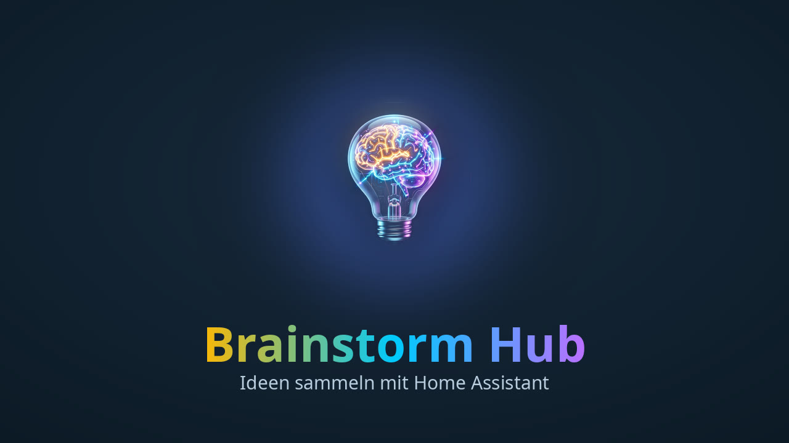

# 🎬 Video: Eigenen Alexa-Skill für Brainstorm einrichten

⬅️ [Alle Videos](videos.md) · [Anleitung](anleitung.md#12-alexa-mit-eigenem-skill) · 📄 [Schriftliche Anleitung in der README](../README_de.md#variante-c-eigener-alexa-skill-optional-ein-satz-eine-antwort)

**[▶️ Video ansehen (MP4, 6 Minuten, deutsch mit Untertiteln im Bild)](https://github.com/nukleuz80/ha_brainstorm/releases/download/v1.9.0/brainstorm-alexa-skill.mp4)**

Das Video führt in 18 Kapiteln durch die Alexa-Entwicklerkonsole, ein Kapitel pro Einstellung. Die markierten Felder zeigen, was du einstellen musst. Die Konsole ist schematisch nachgezeichnet, Amazon ändert ihre Oberfläche gelegentlich, die Bezeichnungen bleiben aber gleich. Die MP4-Datei enthält Kapitelmarken, die die meisten Player (VLC, QuickTime, Plex) anzeigen.

## Kapitel

| Zeit | Kapitel | Einstellung |
| :--- | :--- | :--- |
| 0:00 | Einleitung | Was der Skill bringt: ein Satz, eine Antwort |
| 0:25 | 1. Voraussetzungen | Gleiches Amazon-Konto wie die Echos, Home Assistant per HTTPS erreichbar |
| 0:55 | 2. Home Assistant: Spracheingabe | **Konfigurieren ➔ Alexa-Spracheingabe & Skill** auf **Skill** oder **Beide** |
| 1:23 | 3. Skill-Name | `Brainstorm` |
| 1:37 | 4. Sprache (Primary locale) | **German (DE)**, passend zur Sprache des Echos |
| 1:51 | 5. Erfahrung & Modell | Modell **Custom** |
| 2:02 | 6. Hosting | **Alexa-hosted (Python)**, Region z. B. **EU (Ireland)** |
| 2:21 | 7. Vorlage | **Start from Scratch**, dann **Create Skill** |
| 2:35 | 8. Interfaces | **Alexa Presentation Language** mit den Hub-Profilen (nur Echo Show) |
| 2:53 | 9. Permissions | **Reminders** (nur für echte Alexa-Erinnerungen) |
| 3:08 | 10. Sprachmodell | **JSON Editor**: Feld *Sprachmodell* einfügen, **Save**, **Build Skill** |
| 3:38 | 11. Aufrufname | **Skill Invocation Name** `brainstorm` nicht ändern |
| 3:52 | 12. Skill-Code | `lambda_function.py` durch Feld *Skill-Code* ersetzen, **Deploy** |
| 4:17 | 13. Test | **Development** einstellen und Satz im Simulator testen |
| 4:39 | 14. Kopplung | In Home Assistant **Absenden**, erster Satz koppelt den Skill |
| 5:02 | 15. Alexa-App | Skill unter den Entwickler-Skills, Berechtigung *Erinnerungen* |
| 5:16 | 16. Alte Routinen aufräumen | Routinen für *„öffne Brainstorm“* im Modus **Skill** löschen |
| 5:29 | 17. Fehlerbehebung | *„Ich weiß nicht, wie ich dabei helfen soll“* und *„nicht gespeichert“* |
| 5:45 | 18. Zusammenfassung | Alle Einstellungen auf einen Blick |

## Intro für weitere Videos

Das animierte Intro mit dem Brainstorm-Logo hängt einzeln am Release v1.7.19 ([`brainstorm-intro.mp4`](https://github.com/nukleuz80/ha_brainstorm/releases/download/v1.7.19/brainstorm-intro.mp4)) (5 Sekunden, 1280×720, 25 fps, AAC mono). Mit anderem Titel erzeugst du es neu, siehe [`tools/video`](../tools/video/README.md).
