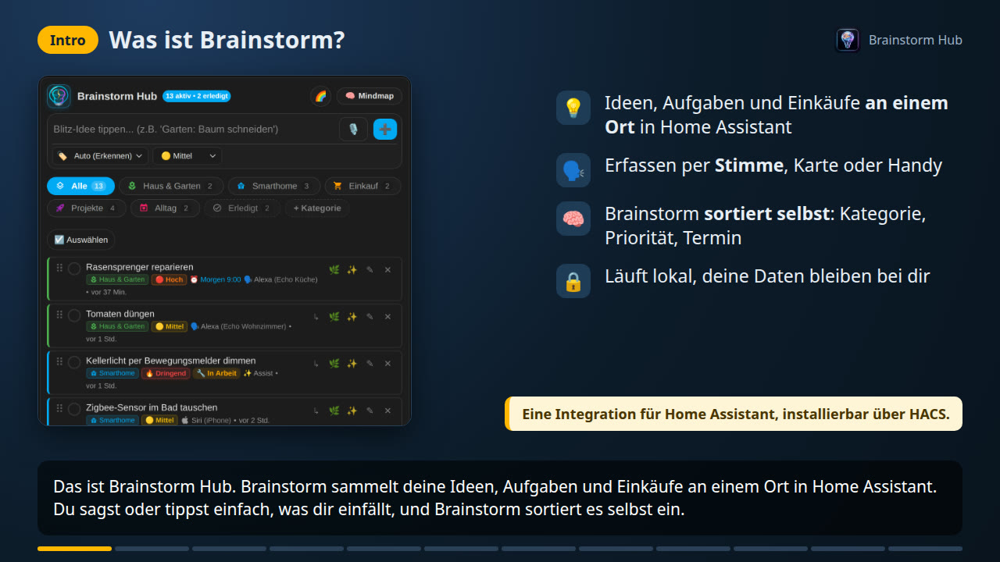
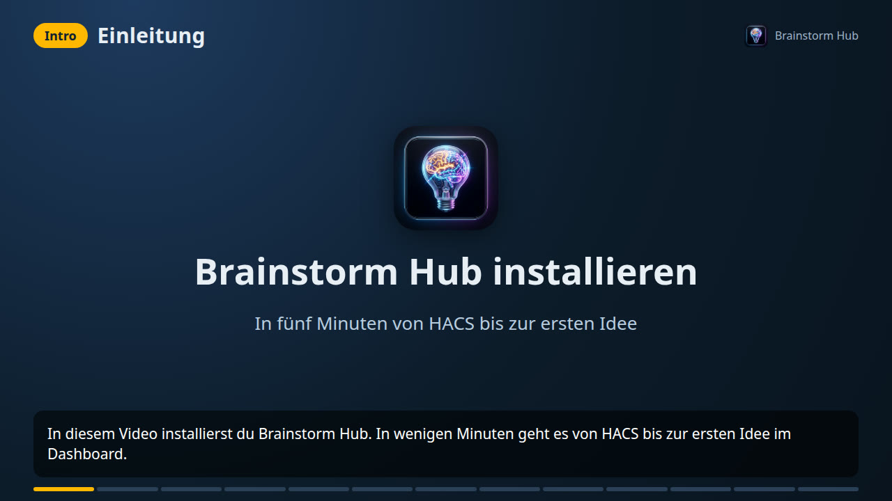
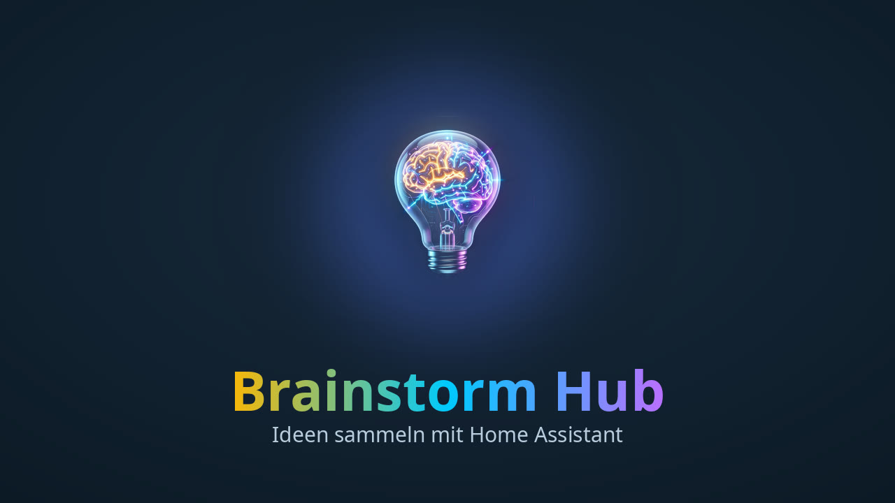
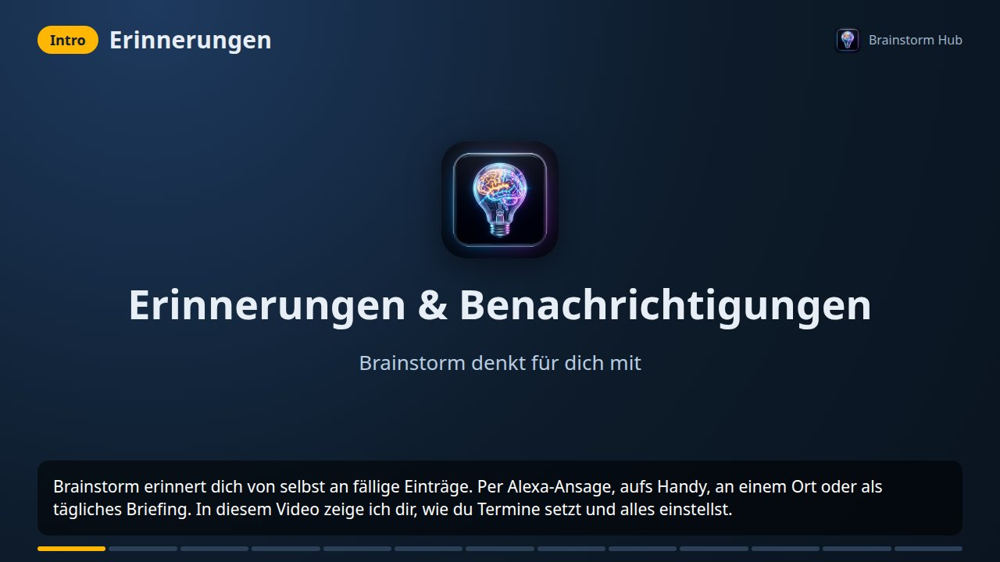
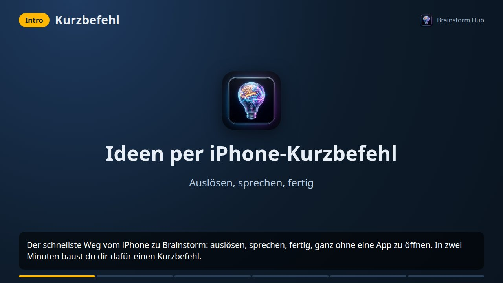
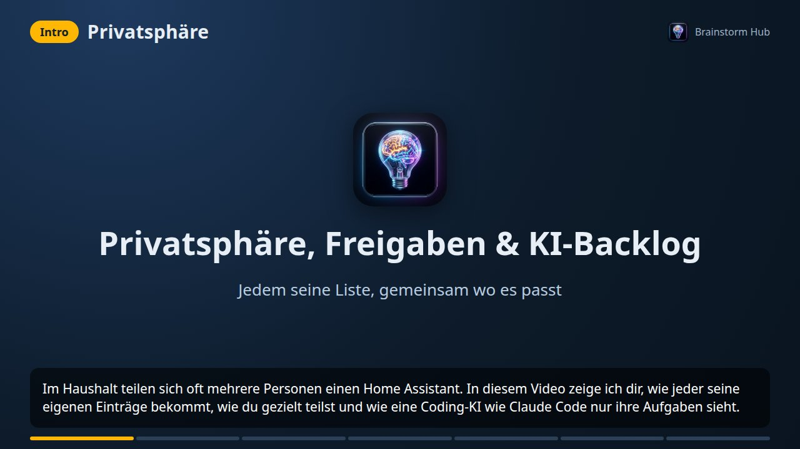

# 🎬 Videos

⬅️ [Zurück zur README](../README_de.md) · 📘 [Anleitung mit Beispielen](anleitung.md)

Alle Videos sind deutsch gesprochen, mit dem Text als Untertitel im Bild. Die MP4-Dateien hängen an den GitHub-Releases und enthalten Kapitelmarken, die die meisten Player (VLC, QuickTime, Plex) anzeigen. Die Karten sind echte Screenshots mit Beispieldaten, Amazon- und Home-Assistant-Dialoge sind schematisch nachgezeichnet.

## Die wichtigsten Funktionen (3½ Minuten)

**[▶️ Video ansehen](https://github.com/nukleuz80/ha_brainstorm/releases/download/v1.10.5/brainstorm-features.mp4)**

| Zeit | Kapitel |
| :--- | :--- |
| 0:00 | Was ist Brainstorm? |
| 0:17 | Erfassen per Stimme: Alexa, Assist, Siri, Mikrofon, KI |
| 0:31 | Versteht ganze Sätze: Text, Termin, Priorität, Kategorie |
| 0:50 | Die Listenkarte und die Bedienstufen Einsteiger, Normal, Profi |
| 1:21 | Unteraufgaben & Details |
| 1:34 | Die Mindmap: Marker, Ansichten, Suche, Regeln, Präsentation, Export |
| 2:19 | Erinnerungen und wiederkehrende Aufgaben |
| 2:33 | Alexa-Skill & Echo Show |
| 2:47 | Erledigt & Ergebnis |
| 3:01 | Verbunden mit allem: To-do, Bring!, Markdown, JSON |
| 3:14 | Privatsphäre & Freigaben |
| 3:26 | Loslegen |

## Installation (3 Minuten)

**[▶️ Video ansehen](https://github.com/nukleuz80/ha_brainstorm/releases/download/v1.7.22/brainstorm-installation.mp4)** · 📄 [Schriftlich in der README](../README_de.md#-installation)

| Zeit | Kapitel |
| :--- | :--- |
| 0:00 | Einleitung |
| 0:13 | Voraussetzungen |
| 0:29 | HACS: Repository hinzufügen |
| 0:52 | Herunterladen |
| 1:01 | Neustart |
| 1:13 | Integration hinzufügen |
| 1:24 | Ersteinrichtung |
| 1:37 | Karte ins Dashboard |
| 1:56 | Mindmap-Karte |
| 2:07 | Die erste Idee |
| 2:19 | Konfigurieren |
| 2:32 | Updates |
| 2:42 | Wie geht's weiter? |

## Eigener Alexa-Skill (6 Minuten)

Ein Kapitel pro Einstellung in der Alexa-Entwicklerkonsole, mit Kapitelliste auf der [eigenen Seite](video-alexa-skill.md).

## Erinnerungen & Benachrichtigungen

**[▶️ Video ansehen](https://github.com/nukleuz80/ha_brainstorm/releases/download/v1.7.22/brainstorm-erinnerungen.mp4)** (3½ Minuten) · 📄 [Schriftlich in der README](../README_de.md#-erinnerungen--benachrichtigungen)

| Zeit | Kapitel |
| :--- | :--- |
| 0:00 | Einleitung |
| 0:19 | Termin per Sprache: was Brainstorm versteht |
| 0:44 | Termin auf der Karte |
| 0:56 | Einschalten: Alexa-Ansage, Benachrichtigungen, Wartezeit |
| 1:23 | Aufs Handy: Erledigt, 1 Stunde später, Morgen |
| 1:37 | Ruhezeit, Briefing, Rückblick und Sperrzeiten pro Echo |
| 2:05 | Regeln pro Liste |
| 2:17 | Orte & Heimkommen |
| 2:30 | Für andere Personen |
| 2:43 | Antworten per Sprache: erledigt, später |
| 2:53 | Kalender & echte Alexa-Erinnerungen |
| 3:08 | Eigene Automationen |
| 3:19 | Zusammenfassung |

## iPhone-Kurzbefehl

**[▶️ Video ansehen](https://github.com/nukleuz80/ha_brainstorm/releases/download/v1.7.22/brainstorm-iphone.mp4)** (2 Minuten) · 📄 [Schriftlich in der README](../README_de.md#3-iphone-kurzbefehl-mit-siri-action-taste-oder-rückseite)

| Zeit | Kapitel |
| :--- | :--- |
| 0:00 | Einleitung und Voraussetzungen |
| 0:23 | Kurzbefehl anlegen, Text diktieren |
| 0:38 | Home Assistant aufrufen: Idee hinzufügen, Datenfeld, Anführungszeichen |
| 1:12 | Auslöser: Action-Taste, Rückseite, Siri |
| 1:26 | Ausprobieren |
| 1:48 | Zusammenfassung |

## Privatsphäre, Freigaben & KI-Backlog

**[▶️ Video ansehen](https://github.com/nukleuz80/ha_brainstorm/releases/download/v1.7.22/brainstorm-privatsphaere.mp4)** (2 Minuten) · 📄 [Schriftlich in der README](../README_de.md#-privatsphäre--freigaben)

| Zeit | Kapitel |
| :--- | :--- |
| 0:00 | Einleitung |
| 0:16 | Einschalten und Hauptbenutzer |
| 0:33 | Freigeben, in fremde Listen schreiben |
| 0:58 | Echos Personen zuordnen |
| 1:12 | Was Privatsphäre nicht kann |
| 1:25 | Backlog für Coding-KIs wie Claude Code |
| 2:02 | Zusammenfassung |

## Selbst erzeugen

Drehbuch, Intro und Werkzeuge liegen unter [`tools/video`](../tools/video/README.md).
