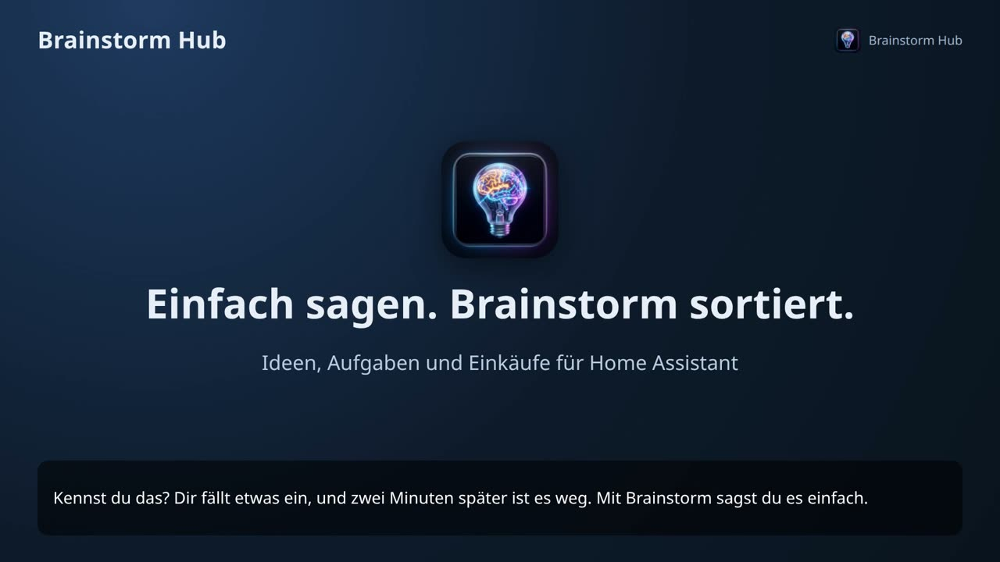
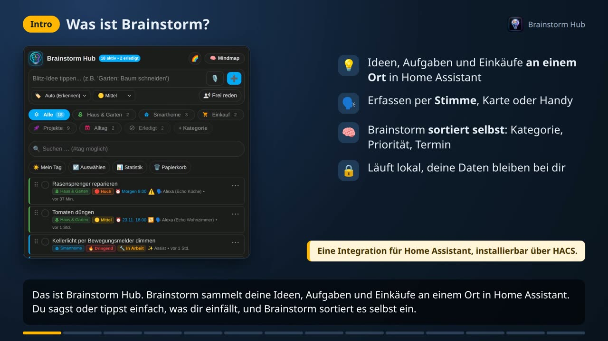
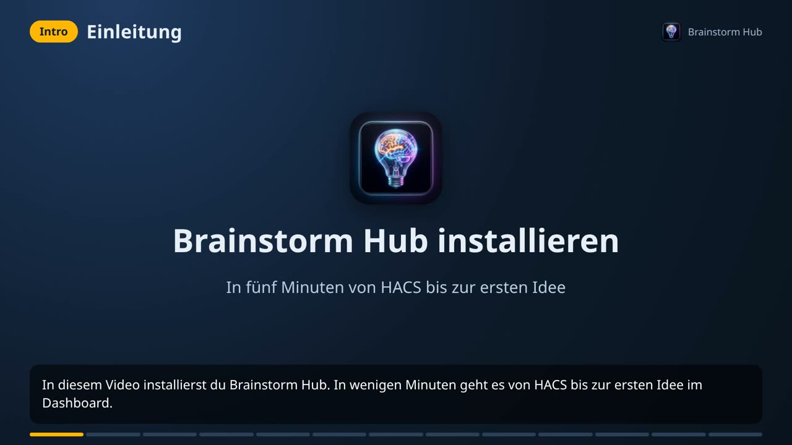
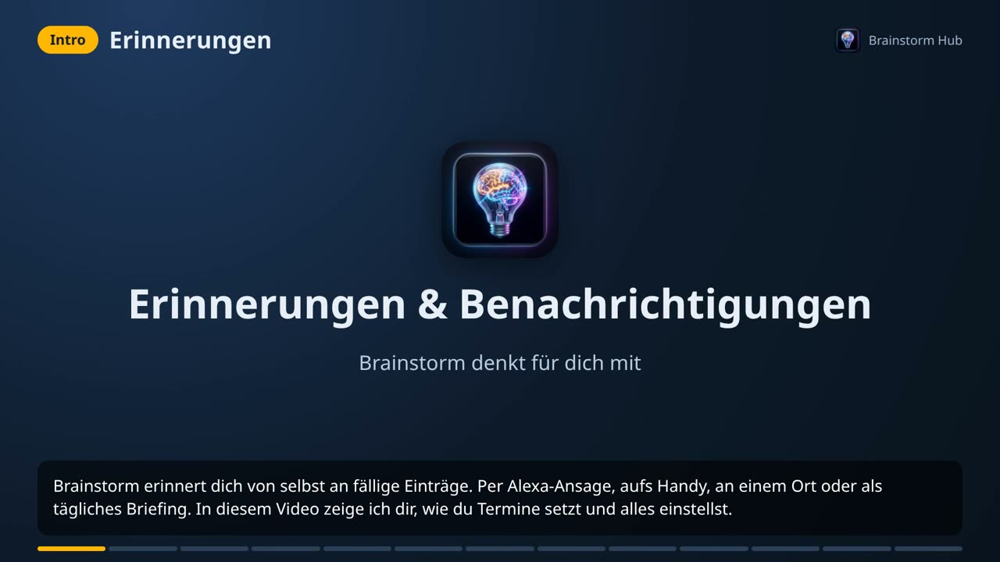
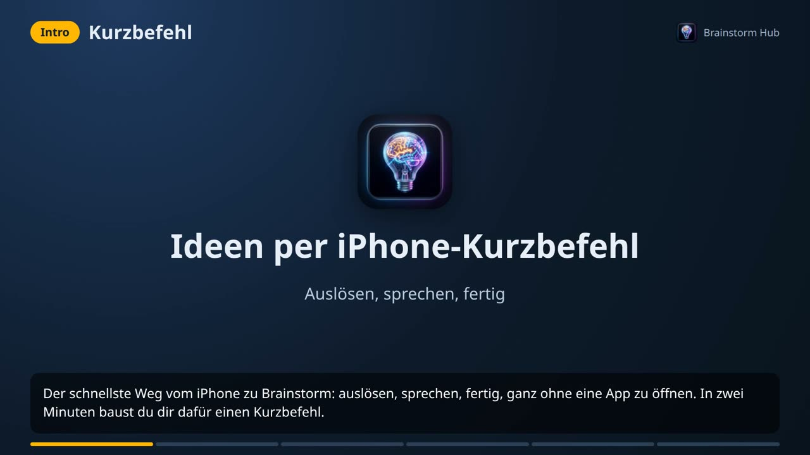
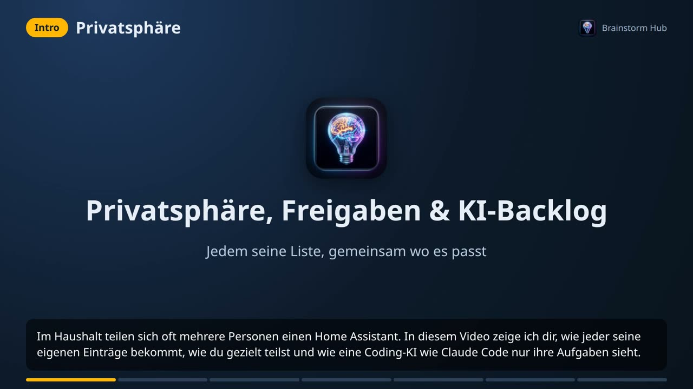

# 🎬 Videos

⬅️ [Zurück zur README](../README_de.md) · 📚 [Wiki](https://github.com/nukleuz80/ha_brainstorm/wiki) · 🇬🇧 [English videos](videos_en.md)

Alle Videos sind deutsch gesprochen (alle gibt es auch [auf Englisch](videos_en.md)) und seit v1.20.7 in Full HD mit echten Klicks in den Karten. Der Text läuft als Untertitel im Bild und liegt zusätzlich als abschaltbare Untertitelspur in der Datei. Die MP4-Dateien hängen an den GitHub-Releases und enthalten Kapitelmarken, die die meisten Player (VLC, QuickTime, Plex) anzeigen. Die Karten sind echt und laufen mit Beispieldaten. Amazon- und Home-Assistant-Dialoge sind schematisch nachgezeichnet.

## Brainstorm in einer Minute (Teaser)

**[▶️ Teaser ansehen](https://github.com/nukleuz80/ha_brainstorm/releases/download/v1.20.7/brainstorm-teaser.mp4)**: Liste, Mindmap und KI-Vorschläge in 52 Sekunden.

## Die wichtigsten Funktionen (5 Minuten)

**[▶️ Video ansehen](https://github.com/nukleuz80/ha_brainstorm/releases/download/v1.20.7/brainstorm-features.mp4)**

| Zeit | Kapitel |
| :--- | :--- |
| 0:00 | Was ist Brainstorm? |
| 0:18 | Erfassen per Stimme: Alexa, Assist, Siri, Mikrofon, KI |
| 0:32 | Versteht ganze Sätze: Text, Termin, Priorität, Kategorie |
| 0:51 | Die Listenkarte und die Bedienstufen Einsteiger, Normal, Profi |
| 1:21 | Unteraufgaben & Details |
| 1:35 | Die Mindmap: Marker, Ansichten, Suche, Regeln, Präsentation, Export |
| 2:20 | Gemeinsam & mit KI: Abstimmen, Reaktionen, Minimap, Kommentare, Map aus Thema |
| 2:59 | Erinnerungen und wiederkehrende Aufgaben |
| 3:14 | Alexa-Skill & Echo Show |
| 3:28 | Erledigt & Ergebnis |
| 3:41 | Verbunden mit allem: To-do, Bring!, Markdown, JSON |
| 3:54 | Privatsphäre & Freigaben |
| 4:07 | Neu dazugekommen: Echo Show, Mindmap aus Webseite oder PDF, Kalender, Messenger & Mail, Batterien, Satz-Tester |
| 4:41 | Loslegen |

## Installation (3 Minuten)

**[▶️ Video ansehen](https://github.com/nukleuz80/ha_brainstorm/releases/download/v1.20.7/brainstorm-installation.mp4)** · 📄 [Schriftlich im Wiki](https://github.com/nukleuz80/ha_brainstorm/wiki/Installation-und-Einrichtung)

| Zeit | Kapitel |
| :--- | :--- |
| 0:00 | Einleitung |
| 0:14 | Voraussetzungen |
| 0:32 | HACS: Repository hinzufügen |
| 0:43 | Herunterladen |
| 0:53 | Neustart |
| 1:05 | Integration hinzufügen |
| 1:15 | Ersteinrichtung |
| 1:29 | Karte ins Dashboard |
| 1:49 | Mindmap-Karte |
| 2:00 | Die erste Idee |
| 2:11 | Konfigurieren |
| 2:24 | Updates |
| 2:34 | Wie geht's weiter? |

## Eigener Alexa-Skill (6 Minuten)

Ein Kapitel pro Einstellung in der Alexa-Entwicklerkonsole, mit Kapitelliste auf der [eigenen Seite](video-alexa-skill.md).

## Erinnerungen & Benachrichtigungen

**[▶️ Video ansehen](https://github.com/nukleuz80/ha_brainstorm/releases/download/v1.20.7/brainstorm-erinnerungen.mp4)** (3½ Minuten) · 📄 [Schriftlich im Wiki](https://github.com/nukleuz80/ha_brainstorm/wiki/Erinnerungen)

| Zeit | Kapitel |
| :--- | :--- |
| 0:00 | Einleitung |
| 0:19 | Termin per Sprache: was Brainstorm versteht |
| 0:43 | Termin auf der Karte |
| 0:56 | Einschalten: Alexa-Ansage, Benachrichtigungen, Wartezeit |
| 1:23 | Aufs Handy: Erledigt, 1 Stunde später, Morgen |
| 1:37 | Ruhezeit, Briefing, Rückblick und Sperrzeiten pro Echo |
| 2:04 | Regeln pro Liste |
| 2:16 | Orte & Heimkommen |
| 2:30 | Für andere Personen |
| 2:43 | Antworten per Sprache: erledigt, später |
| 2:53 | Kalender & echte Alexa-Erinnerungen |
| 3:09 | Eigene Automationen |
| 3:20 | Zusammenfassung |

## iPhone-Kurzbefehl

**[▶️ Video ansehen](https://github.com/nukleuz80/ha_brainstorm/releases/download/v1.20.7/brainstorm-iphone.mp4)** (2 Minuten) · 📄 [Schriftlich im Wiki](https://github.com/nukleuz80/ha_brainstorm/wiki/Sprachsteuerung#iphone-kurzbefehl-mit-siri-action-taste-oder-rückseite)

| Zeit | Kapitel |
| :--- | :--- |
| 0:00 | Einleitung und Voraussetzungen |
| 0:24 | Kurzbefehl anlegen, Text diktieren |
| 0:38 | Home Assistant aufrufen: Idee hinzufügen, Datenfeld, Anführungszeichen |
| 1:13 | Auslöser: Action-Taste, Rückseite, Siri |
| 1:26 | Ausprobieren |
| 1:48 | Zusammenfassung |

## Privatsphäre, Freigaben & KI-Backlog

**[▶️ Video ansehen](https://github.com/nukleuz80/ha_brainstorm/releases/download/v1.20.7/brainstorm-privatsphaere.mp4)** (2 Minuten) · 📄 [Schriftlich im Wiki](https://github.com/nukleuz80/ha_brainstorm/wiki/Zusammenarbeit)

| Zeit | Kapitel |
| :--- | :--- |
| 0:00 | Einleitung |
| 0:17 | Einschalten und Hauptbenutzer |
| 0:34 | Freigeben, in fremde Listen schreiben |
| 0:59 | Echos Personen zuordnen |
| 1:13 | Was Privatsphäre nicht kann |
| 1:25 | Backlog für Coding-KIs wie Claude Code |
| 2:02 | Zusammenfassung |

## Selbst erzeugen

Drehbuch, Intro und Werkzeuge liegen unter [`tools/video`](../tools/video/README.md).
