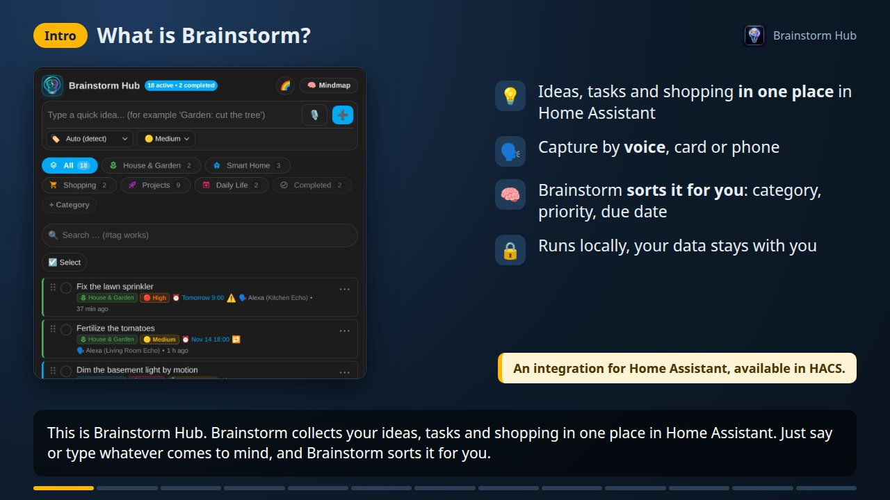
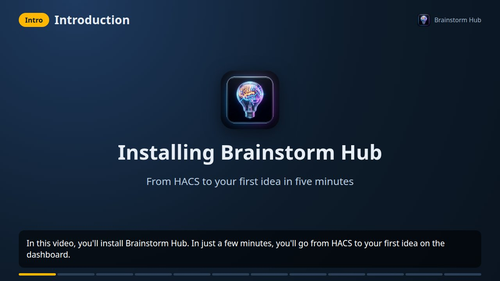
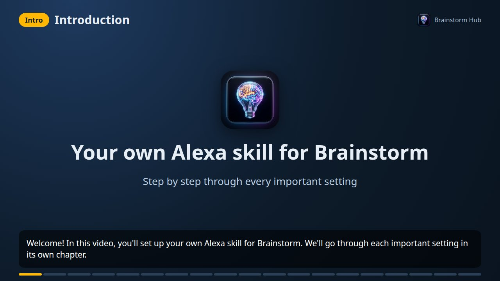
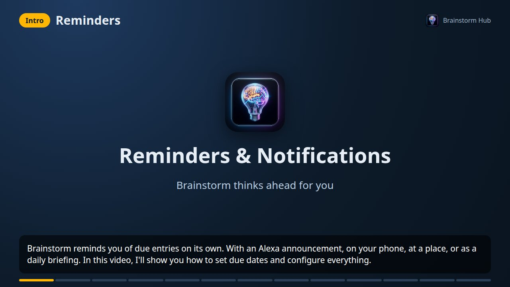
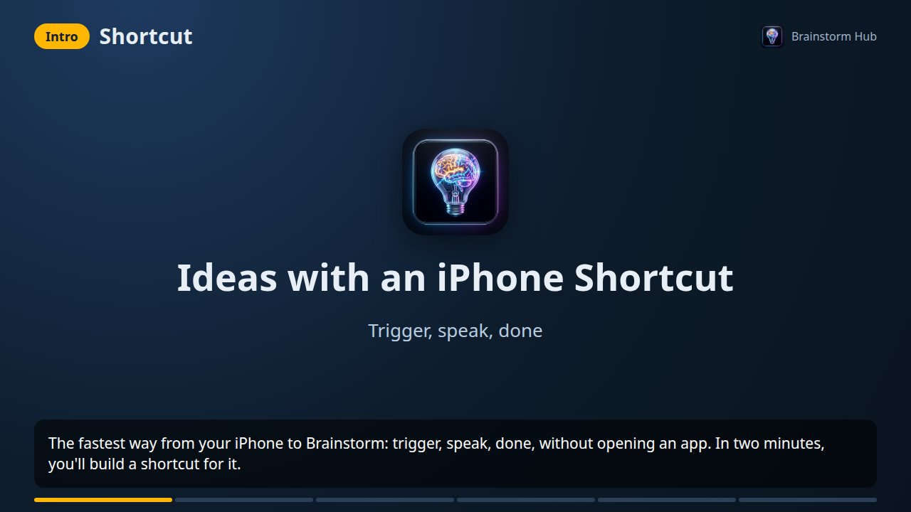
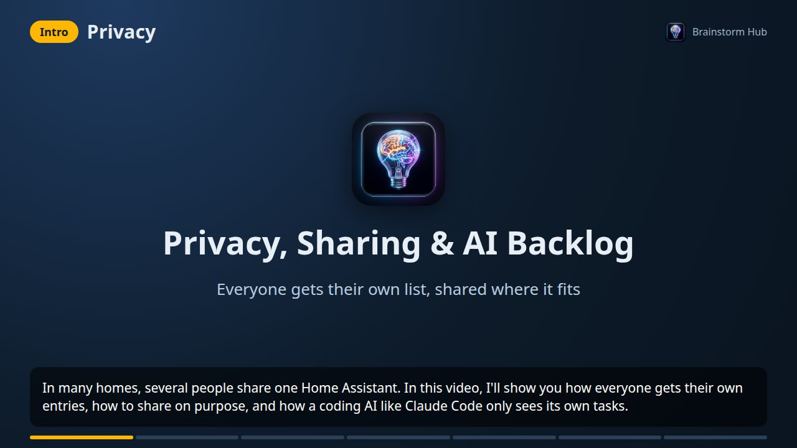

# 🎬 Videos

⬅️ [Back to the README](../README.md) · 📚 [Wiki](https://github.com/nukleuz80/ha_brainstorm/wiki) · 🇩🇪 [Deutsche Videos](videos.md)

All videos are narrated in English, with the text as subtitles on screen. The MP4 files are attached to the GitHub releases and contain chapter marks that most players (VLC, QuickTime, Plex) show. The cards are real screenshots with sample data, Amazon and Home Assistant dialogs are drawn schematically.

## The key features (4 minutes)

**[▶️ Watch the video](https://github.com/nukleuz80/ha_brainstorm/releases/download/v1.11.9/brainstorm-features-en.mp4)**

Everything Brainstorm Hub does, from voice capture to the mind map, voting and AI.

| Time | Chapter |
| :--- | :--- |
| 0:00 | What is Brainstorm? |
| 0:18 | Capture by voice |
| 0:32 | Understands whole sentences |
| 0:51 | The list card |
| 1:21 | Subtasks & details |
| 1:34 | The mind map |
| 2:19 | Together & with AI |
| 2:57 | Reminders |
| 3:12 | Alexa skill & Echo Show |
| 3:26 | Done & result |
| 3:37 | Connected to everything |
| 3:50 | Privacy & sharing |
| 4:02 | Get started |

## Installation (2 minutes)

**[▶️ Watch the video](https://github.com/nukleuz80/ha_brainstorm/releases/download/v1.11.9/brainstorm-installation-en.mp4)** · 📄 [Written guide in the wiki](https://github.com/nukleuz80/ha_brainstorm/wiki/Installation-and-Setup)

From HACS to your first idea on the dashboard.

| Time | Chapter |
| :--- | :--- |
| 0:00 | Introduction |
| 0:14 | Requirements |
| 0:29 | Download in HACS |
| 0:48 | Restart |
| 0:58 | Add the integration |
| 1:07 | First setup |
| 1:20 | Add the card |
| 1:38 | Mind map card |
| 1:45 | Your first idea |
| 1:56 | Configure |
| 2:07 | Updates |
| 2:15 | What's next? |

## Your own Alexa skill (6 minutes)

**[▶️ Watch the video](https://github.com/nukleuz80/ha_brainstorm/releases/download/v1.11.9/brainstorm-alexa-skill-en.mp4)** · 📄 [Written guide in the wiki](https://github.com/nukleuz80/ha_brainstorm/wiki/Voice-Control#️-optional-your-own-alexa-skill-one-sentence-one-answer)

One chapter per setting in the Alexa developer console. The console is drawn schematically: Amazon changes its layout now and then, but the labels stay the same.

| Time | Chapter |
| :--- | :--- |
| 0:00 | Introduction |
| 0:25 | Requirements |
| 0:53 | Home Assistant: voice input |
| 1:19 | Skill name |
| 1:32 | Language (primary locale) |
| 1:46 | Experience & model: Custom |
| 1:57 | Hosting: Alexa-hosted (Python) |
| 2:14 | Template: Start from Scratch |
| 2:26 | Interfaces: Alexa Presentation Language |
| 2:44 | Permissions: Reminders |
| 2:57 | Voice model: JSON Editor |
| 3:26 | Invocation name |
| 3:39 | Skill code: lambda_function.py |
| 4:01 | Test: Development |
| 4:23 | Link with Home Assistant |
| 4:45 | Alexa app: skill & permission |
| 4:58 | Clean up old routines |
| 5:12 | Troubleshooting |
| 5:28 | Summary |

## Reminders & notifications (3 minutes)

**[▶️ Watch the video](https://github.com/nukleuz80/ha_brainstorm/releases/download/v1.11.9/brainstorm-reminders-en.mp4)** · 📄 [Written guide in the wiki](https://github.com/nukleuz80/ha_brainstorm/wiki/Reminders)

Due dates by voice or on the card, Alexa announcements, phone notifications, places, quiet hours and rules per list.

| Time | Chapter |
| :--- | :--- |
| 0:00 | Reminders |
| 0:18 | Due date by voice |
| 0:44 | Due date on the card |
| 0:55 | Turn it on |
| 1:20 | On your phone |
| 1:34 | Quiet hours, briefing & review |
| 2:00 | Rules per list |
| 2:12 | Places & coming home |
| 2:26 | For other people |
| 2:36 | Answer by voice |
| 2:46 | Calendar & real Alexa reminders |
| 3:01 | Your own automations |
| 3:10 | Have fun |

## iPhone shortcut (2 minutes)

**[▶️ Watch the video](https://github.com/nukleuz80/ha_brainstorm/releases/download/v1.11.9/brainstorm-iphone-en.mp4)** · 📄 [Written guide in the wiki](https://github.com/nukleuz80/ha_brainstorm/wiki/Voice-Control#-iphone-shortcut-with-siri-action-button-or-back-tap)

Capture ideas with Siri, the Action button or Back Tap.

| Time | Chapter |
| :--- | :--- |
| 0:00 | Shortcut |
| 0:22 | Create the shortcut |
| 0:36 | Call Home Assistant |
| 1:04 | Choose a trigger |
| 1:17 | Try it |
| 1:39 | Have fun |

## Privacy, sharing & AI backlog (2 minutes)

**[▶️ Watch the video](https://github.com/nukleuz80/ha_brainstorm/releases/download/v1.11.9/brainstorm-privacy-en.mp4)** · 📄 [Written guide in the wiki](https://github.com/nukleuz80/ha_brainstorm/wiki/Collaboration)

Own entries per person, sharing, Echos per person, and a task list for coding AIs.

| Time | Chapter |
| :--- | :--- |
| 0:00 | Privacy |
| 0:19 | Turn it on |
| 0:33 | Share |
| 0:55 | Assign Echos to people |
| 1:08 | What privacy can't do |
| 1:19 | Backlog for coding AIs |
| 1:54 | Have fun |
