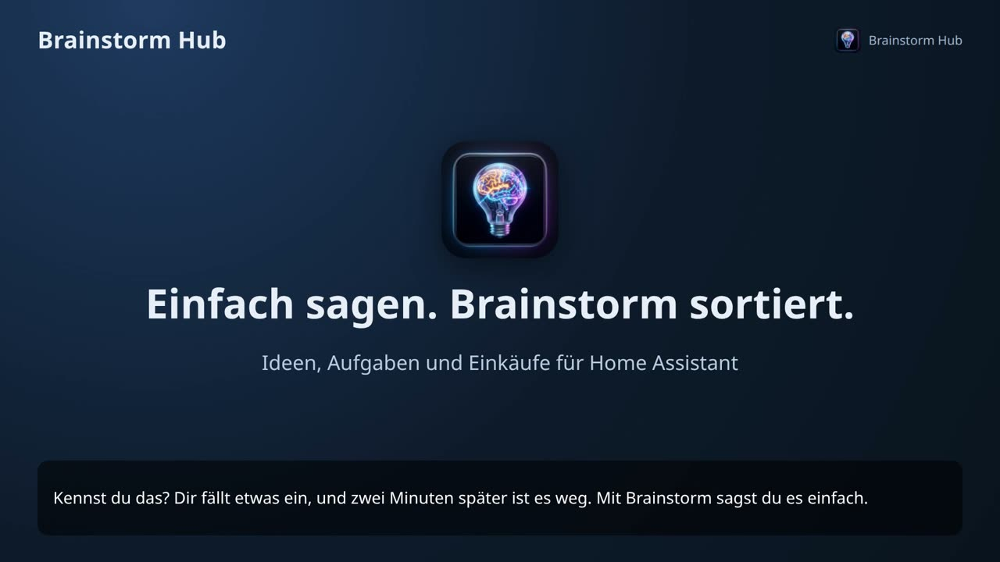
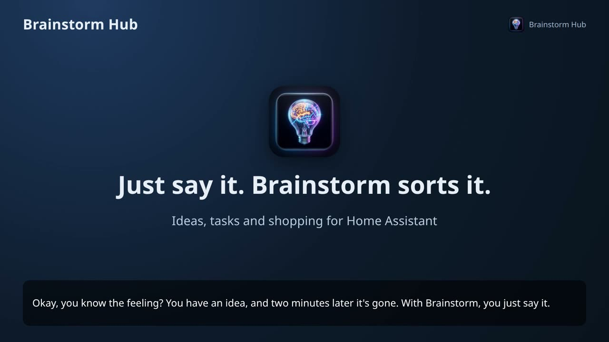

# 🧠 Brainstorm Hub Wiki

**Ideen, Notizen, Aufgaben und Mindmaps für Home Assistant, per Sprache mit Alexa, Assist und Siri** 
**Ideas, notes, tasks and mind maps for Home Assistant, by voice with Alexa, Assist and Siri**

 

🎬 **Brainstorm in einer Minute** (links, deutsch) · **Brainstorm in one minute** (right, English)

| 🇩🇪 Deutsch | 🇬🇧 English |
| :--- | :--- |
| **Einstieg** | **Getting started** |
| 📦 [Installation & Einrichtung](Installation-und-Einrichtung) | 📦 [Installation & Setup](Installation-and-Setup) |
| 🚀 [Schnellstart in 5 Minuten](Schnellstart) | 🚀 [Quick Start in 5 minutes](Quick-Start) |
| **Anleitungen** | **How-to guides** |
| 📋 [Listenkarte](Listenkarte) | 📋 [List Card](List-Card) |
| 🧠 [Mindmap & Pinnwand](Mindmap-und-Pinnwand) | 🧠 [Mind Map & Pinboard](Mind-Map-and-Pinboard) |
| 👥 [Zusammenarbeit](Zusammenarbeit) | 👥 [Collaboration](Collaboration) |
| 🗣️ [Sprachsteuerung](Sprachsteuerung) | 🗣️ [Voice Control](Voice-Control) |
| ✨ [KI-Funktionen](KI-Funktionen) | ✨ [AI Features](AI-Features) |
| ⏰ [Erinnerungen](Erinnerungen) | ⏰ [Reminders](Reminders) |
| 🤖 [Automationen & Beispiele](Automationen-und-Beispiele) | 🤖 [Automations & Examples](Automations-and-Examples) |
| **Nachschlagen** | **Reference** |
| 🎛️ [Einstellungen](Einstellungen) | 🎛️ [Settings](Settings) |
| 🛠️ [Dienste & Ereignisse](Dienste-und-Ereignisse) | 🛠️ [Services & Events](Services-and-Events) |
| 🧩 [Entitäten & Attribute](Entitäten-und-Attribute) | 🧩 [Entities & Attributes](Entities-and-Attributes) |
| 💾 [Import, Export & Speicherung](Import-Export-und-Speicherung) | 💾 [Import, Export & Storage](Import-Export-and-Storage) |
| **Hilfe** | **Help** |
| 🩺 [Fehlerbehebung & FAQ](Fehlerbehebung-und-FAQ) | 🩺 [Troubleshooting & FAQ](Troubleshooting-and-FAQ) |

**Mehr / More:** 📖 [README (DE)](https://github.com/nukleuz80/ha_brainstorm/blob/main/README_de.md) · 📖 [README (EN)](https://github.com/nukleuz80/ha_brainstorm#readme) · 📜 [Changelog](https://github.com/nukleuz80/ha_brainstorm/blob/main/CHANGELOG.md) · 🎬 Videos ([DE](https://github.com/nukleuz80/ha_brainstorm/blob/main/docs/videos.md), [EN](https://github.com/nukleuz80/ha_brainstorm/blob/main/docs/videos_en.md)) · 🐞 [Issues](https://github.com/nukleuz80/ha_brainstorm/issues)

> [!NOTE]
> Dieses Wiki wird aus dem Ordner [`wiki/`](https://github.com/nukleuz80/ha_brainstorm/tree/main/wiki) im Repository erzeugt. Änderungen bitte dort als Pull Request vorschlagen. 
> This wiki is built from the [`wiki/`](https://github.com/nukleuz80/ha_brainstorm/tree/main/wiki) folder of the repository. Please suggest changes there as a pull request.
