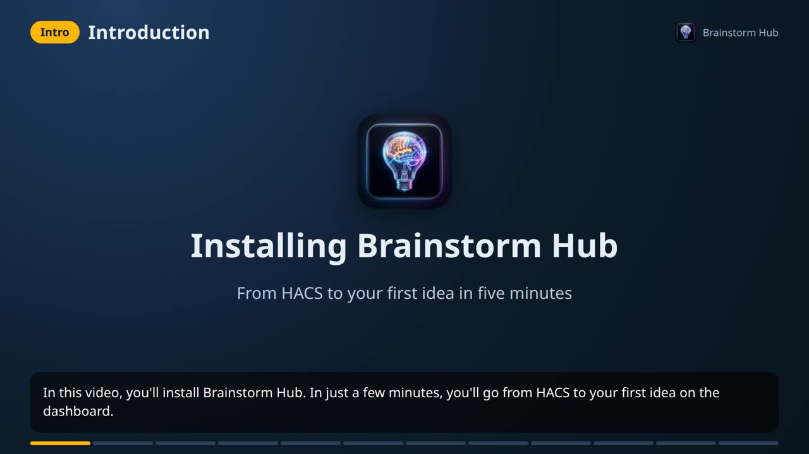

🏠 [Home](Home) · 🇩🇪 [Deutsche Version](Installation-und-Einrichtung)

> 🎬 **Prefer to watch?** The [installation video](https://github.com/nukleuz80/ha_brainstorm/blob/main/docs/videos_en.md#installation-2-minutes) goes from installing to your first idea in two minutes.

## 🔗 Quick Links

These buttons open the right page in your own Home Assistant:

      

The links go through [My Home Assistant](https://my.home-assistant.io/). On the first click it asks for the address of your Home Assistant and remembers it. Throughout this wiki, menu paths such as **Settings ➔ Devices & Services** are links of this kind too, and every action under [Services](Services-and-Events) has a link that opens it in the developer tools.

## Prerequisites

1. Home Assistant 2026.10 or newer.
2. On Home Assistant 2026.10: [HACS](https://hacs.xyz), if you want to install through it. From 2026.11 on it is built in as the **Marketplace**.
3. Optional, for voice input with Alexa: the [Alexa Media Player](https://github.com/alandtse/alexa_media_player) integration.
4. Optional, for your own Alexa skill: an Amazon developer account and a public HTTPS address for your Home Assistant.

Brainstorm Hub connects to no external service by itself, so setup needs no account or password.

## Option 1: Marketplace (Recommended - 1-Click)

Brainstorm Hub is part of the HACS default list since 9 November 2026. Since Home Assistant 2026.11 that list is built in as the **Marketplace**. Click the button below to open Brainstorm Hub there:

Or step by step:
1. Open **Settings ➔ Marketplace** in Home Assistant (on 2026.10: **HACS** in the sidebar) and switch to **Browse**.
2. Search for **Brainstorm Hub** and click **Install** (in HACS: **Download**).
3. Restart Home Assistant.

The cards come with the integration: after the restart Home Assistant loads them by itself. Then add the integration as shown in the next option.

## Option 2: Add Integration (Config Flow)

1. Go to [**Settings ➔ Devices & Services ➔ Add Integration**](https://my.home-assistant.io/redirect/config_flow_start/?domain=brainstorm).
2. Search for **Brainstorm Hub** and follow the on-screen setup guide.

## Option 3: Manual Installation

1. Download the latest release.
2. Copy the folder `custom_components/brainstorm` to `/config/custom_components/`.
3. Restart Home Assistant and add the integration as shown in option 2.

## The Cards

The cards live in the folder of the integration (`cards/`), and Home Assistant loads them on every dashboard by itself, in storage and YAML mode alike. There is nothing to copy and no resource to add.

> **Updating from a version before 1.7.15:** Remove the old resources `/local/brainstorm-card.js` and `/local/brainstorm-mindmap-card.js` under [**Settings ➔ Dashboards ➔ Resources**](https://my.home-assistant.io/redirect/lovelace_resources/) (or from `resources:` in YAML mode) and delete the card files in `/config/www/`. Otherwise the browser may still load the old cards.

## Removing the Integration

1. Go to [**Settings ➔ Devices & Services ➔ Brainstorm Hub**](https://my.home-assistant.io/redirect/integration/?domain=brainstorm), open the three dots and choose **Delete**.
2. Installed through the Marketplace (or HACS): open Brainstorm Hub there and choose **Remove**. Installed manually: delete `/config/custom_components/brainstorm`.
3. Remove any Brainstorm cards from your dashboards.
4. Restart Home Assistant.

Depending on what you used, also remove:
- **Your Alexa skill:** Delete it in the Alexa developer console and its code in AWS Lambda. Real Alexa reminders stay in the Alexa app until you delete them there.
- **Automations and sentences:** Your own automations, scripts, and custom sentences that call Brainstorm, as well as an iPhone shortcut.
- **Your data:** Home Assistant keeps your ideas in `/config/.storage/brainstorm.storage`, the skill link in `brainstorm.alexa_skill` and the reminder state in `brainstorm.reminders` in the same folder. Delete these files and the Markdown folder (default `/config/brainstorm`) if you do not plan to come back.
